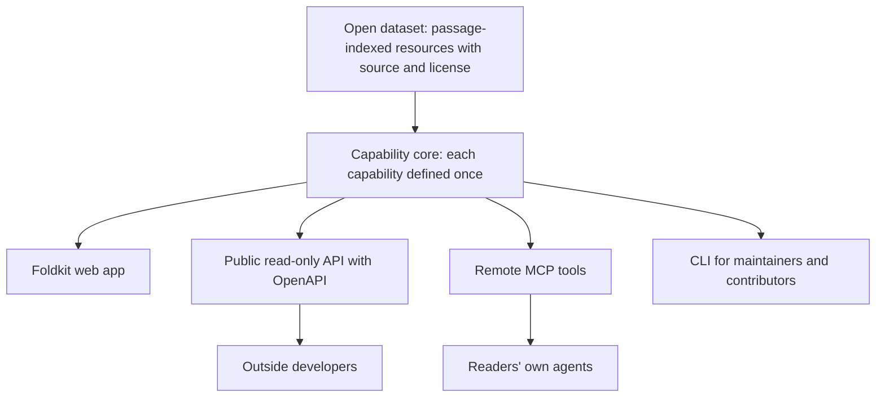
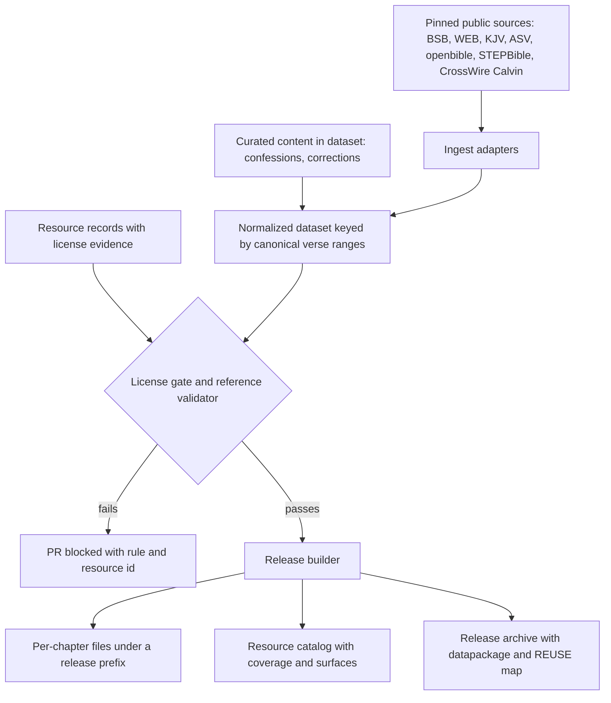
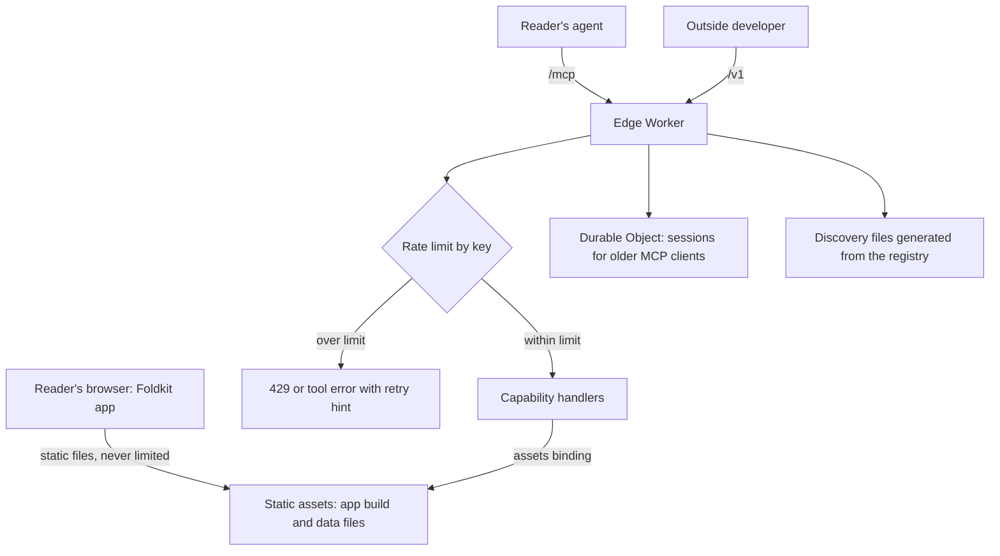
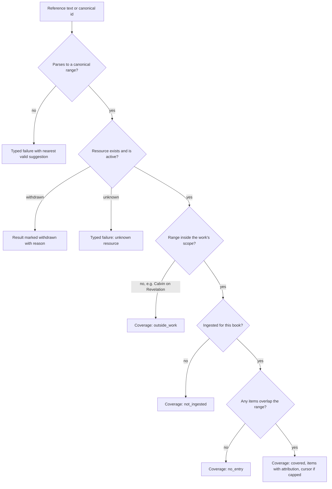

# Reformed Bible Study App - Plan

## Goal Capsule

- **Objective:** A Reformed-leaning lay reader can study any passage of Romans with free, openly licensed Reformed resources beside the text, either in a browser or through their own AI agent, and every resource shown traces to a source that others may reuse.
- **Means:** Content is prebuilt into per-chapter files from an open, license-checked dataset (KTD2). One set of Effect capability handlers reads those files in the browser, in a Cloudflare Worker that serves the public API and MCP, and in a maintainer CLI (KTD1, KTD3).
- **Product authority:** The project owner. The Product Contract sets product-wide rules that every later component inherits. Only the First Release Slice is active scope. When a requirement and a technical decision disagree, the requirement wins on product behavior and the KTD wins on mechanism.
- **Stop conditions:** Stop and ask the owner if the Westminster Standards cannot be sourced cleanly (R30), if no MCP client in the smoke list can connect, or if a pinned Foldkit, Effect or Alchemy version blocks a unit and the previous pin does not resolve it. A single resource that fails the license gate is dropped from the release, and work continues.
- **Execution profile:** Greenfield repository. Five pull requests, grouped and ordered in Implementation Units. Nothing is deployed before the last group.
- **Who finishes:** An implementing agent (`ce-work`) or the owner builds each group. The owner merges, owns the Cloudflare account and domain, and sends licensor permission requests.
- **Open blockers:** None.

---

## Product Contract

### Summary

A free, open-source Bible study app built on one shared core with several ways in. A reader opens a passage and arranges study panels beside it: full Reformed commentaries, the confession articles that cite the passage, cross-references, and Greek or Hebrew help. The same capabilities are available to readers' own AI agents over MCP and to other developers through a public API. Every resource carries its source and license, and the corpus is published as an open dataset.

### Problem Frame

Serious Bible study software such as Logos costs a great deal, and most of that cost pays for licensed modern content. The best Reformed material is free: Calvin and the Puritan commentators are public domain, the Reformed confessions are public domain in their original translations, and high-quality Hebrew and Greek data is openly licensed. That material is scattered across sites with different terms, and none of it is connected to the passage a reader is studying or to the confessions that interpret it.

Existing free tools do not fill the gap. Deep Dive Bible, launched 2026-11-02, offers many classic commentaries for free, but its curation is told to "look past Calvin" and it has no confessional layer. The owner studies with the ESV Study Bible and Logos today, and wants Reformed readers without a Logos budget to have comparable depth for free. A secondary goal is to learn a modern TypeScript stack by building it.

### Actors

- A1. Reader: a Reformed-leaning lay Bible student using the web app, signed out.
- A2. Reader's agent: an AI assistant such as Claude, ChatGPT, Pi or Cursor, connected by the reader over MCP.
- A3. Outside developer: someone building another app or tool on the public API or the open dataset.
- A4. Contributor: someone who adds or corrects resources in the open dataset through pull requests.
- A5. Maintainer: the project owner, who reviews licenses, ingests resources, and reviews AI-drafted curated notes.

### Key Decisions

- **Study workbench with reader-arranged panels.** The reader picks the layout, as Logos allows, instead of the app imposing one study shape. Governs R2, R3. (session-settled: user-directed — chosen over picking one of three sketched layouts, namely curated notes, commentaries beside text, or both staged: readers should choose their own layouts, tools and options)
- **Workbench as the product, with an open corpus and a confessions panel folded in.** Governs R5, R10, R12. (session-settled: user-approved — chosen over a corpus-first product with a thin viewer, and over a confession-first app with doctrine as the front door: delivers the goal with the least added scope)
- **Free forever and open source.** No revenue features. Openness also decides licensing: only redistributable content can live in a public repo. Governs R10, R11, R23.
- **Agent-friendly from launch.** The owner treats agent access as a must. Agents also get discovery capabilities so they can learn what exists and what is covered without full-text search. Governs R16, R17, R18, R19, R20, R21. (session-settled: user-approved — chosen over adding server-side code mode at launch, and over MCP only with an internal API: agents that already run code mode, such as Pi, can script against MCP on their own machines)
- **Rate limits that do not pool vendor users or touch web reading.** Claude.ai and ChatGPT call from shared vendor addresses, so plain per-address limits would throttle all their users together. Governs R20. (session-settled: user-approved — chosen over plain per-address limits: shared vendor addresses would throttle every Claude.ai or ChatGPT user as one)
- **No accounts at launch.** All personal data stays on the device. Governs R7, R20, R26. (session-settled: user-approved — chosen over optional sign-in with sync at launch, and over required accounts: avoids privacy, deletion and security obligations while sync is not yet needed)
- **Modern TypeScript stack: Foldkit on Effect, with oxlint, oxfmt, Alchemy and Cloudflare.** Governs R24. (session-settled: user-approved — chosen over React with TanStack Router as in t3code: the owner wants to build with this stack, and reusing UI code in Expo is not needed now; mobile is decided later)
- **The app never calls an AI at runtime.** With no revenue, in-app AI is an open-ended cost. Readers bring their own agents instead. Governs R15, R22.
- **KJV-tradition verse numbering everywhere.** Seventeenth-century proof texts, Calvin's English edition, and most English translations already use it. Governs R27, R28.
- **The Greek panel leads with the SBL Greek New Testament.** Differences from the KJV's underlying text are noted. Governs R29. (session-settled: user-approved — chosen over leading with the Byzantine or Textus Receptus text: the critical text is the openly licensed default, and TR differences stay visible)
- **Slice coverage: whole-Bible text, cross-references, confessions and original languages; Romans-only commentary.** Romans stays the quality bar for commentary alignment while proof-text links leave Romans freely.
- **The slice launches on the Westminster Standards.** Free digital editions of the other confessions lack proof texts or carry doubtful licenses, so they join as each clears the license gate. Governs R30.
- **Market durability is not a goal.** The app is judged by usefulness to its readers, not by its position against Logos, Deep Dive Bible, or AI assistants. (session-settled: user-directed — chosen over designing for differentiation against competitors and AI: the owner considers it an irrelevant hypothetical)

### Requirements

**Study experience**

- R1. A reader opens any passage by typing a reference or following a shareable URL, and reads it in an openly licensed translation, with the Berean Standard Bible as the default.
- R2. Study tools appear as independent panels beside the passage: full commentaries, confession articles citing the passage, cross-references, original-language help, and, in a later component, curated notes.
- R3. A reader adds, removes and arranges panels, starting from a default arrangement. The three sketched shapes (curated notes first, commentaries beside the text, both staged) become presets in a later component.
- R4. Each curated note links to the full commentary passage it was drawn from.
- R5. Confessions are navigable in both directions: from a verse to the articles citing it, and from an article to its proof texts. Coverage is the Westminster Confession and Catechisms, the Three Forms of Unity, and the 1689 London Baptist Confession, in public domain translations.
- R6. Original-language help shows the Greek or Hebrew for each verse with Strong's numbers and lexicon glosses. A full reverse interlinear is not required.
- R7. A reader keeps personal notes and highlights on the device, can export and import them, and they are shaped so optional sync can be added later without migrating them.
- R8. The web app installs to a phone's home screen and works offline for the translations and books the reader chooses to download.
- R9. When a panel has no content for the current passage, it says the passage is not yet covered instead of appearing empty.
- R26. Panel arrangement and reading position persist on the device, shaped so optional sync can be added later.
- R27. A link to a verse opens its chapter scrolled to and highlighting that verse, and panels follow whichever verse the reader selects.
- R28. Verse numbering follows the KJV tradition across every translation and resource. Where a translation lacks a verse, a marker at that spot says the verse is not in this translation.
- R29. The Greek text shown is the SBL Greek New Testament, with a note wherever the KJV's underlying text differs.

**Content and licensing**

- R10. A resource ships only if its source declares public domain or an open license, and it carries a recorded source, license and attribution.
- R11. Content from editions that restrict redistribution, including CCEL and Monergism editions, ships only with written permission recorded beside it.
- R12. The corpus is published as an open, passage-indexed dataset that others can reuse and fork without the app.
- R13. Contributors add or correct resources by pull request to the dataset, without running the app.
- R14. A licensed translation, with the ESV first, can be added later without redesign, and never enters the open dataset.
- R15. Curated notes may be drafted by AI offline, and ship only after a maintainer reviews them.
- R30. The slice launches once the Westminster Confession and its Larger and Shorter Catechisms are available. The Three Forms of Unity and the 1689 Confession join as each clears R10.

**Shared core and agent access**

- R16. Each capability is defined once and serves the web app, the public API and MCP with identical behavior. The capabilities are: listing resources with their coverage and license, resolving a free-form reference, passage text, commentary on a passage, confession articles citing a passage, a confession article with its proof texts, a confession's outline, cross-references, the original-language words of a verse, and a lexicon entry.
- R17. A public, read-only HTTP API with OpenAPI documentation exposes the capabilities.
- R18. A remote MCP server exposes the capabilities as tools, and every result carries source attribution.
- R19. The site publishes agent discovery files, including llms.txt and MCP discovery metadata.
- R20. Public endpoints require no account or key. Rate limits bound abuse and cost without pooling all users of one agent vendor together, and reading in the web app is never rate-limited.
- R21. Once public, a capability's shape changes only through a new version.
- R22. The app calls no AI model at runtime.

**Platform**

- R23. The app is free to use, has no revenue features, and its code is open source.
- R24. The web UI is built with Foldkit on an Effect core, linted and formatted with oxlint and oxfmt, written in TypeScript, and deployed to Cloudflare with Alchemy. It adopts rat-stack's capability pattern and layout rather than forking that repository.
- R25. Passage pages are server-rendered for sharing and search indexing where Foldkit's experimental server rendering allows. Launch does not wait on it.



### First Release Slice

The active scope is Romans, end to end. Bible text, cross-references, confessions and original-language help cover the whole Bible, and commentary covers Romans only. The slice covers R1, R2 without curated notes, R3 without presets, R5 within the launch bar of R30, R6, R9 to R13, R16 to R24, and R26 to R30. R4, R7, R8, R14, R15, R25 and presets belong to later components. Commentaries in the slice are limited to those whose clean source is confirmed under R10. Calvin's Romans commentary is confirmed.

### Key Flows

- F1. Study a passage in the browser
  - **Trigger:** A1 opens a shared link to Romans 8:28, or types the reference.
  - **Actors:** A1
  - **Steps:** Chapter 8 loads in the default translation with 8:28 highlighted. Default panels show Calvin's comment, the confession articles citing the verse, cross-references and the Greek. The reader opens a confession article and follows one of its proof texts to another passage. The reader removes one panel and adds another.
  - **Outcome:** The arrangement persists on that device.
  - **Covered by:** R1, R2, R3, R5, R6, R26, R27
- F2. An agent answers with Reformed sources
  - **Trigger:** A1 asks their agent what Calvin says on Romans 8:28 and which confession articles cite it.
  - **Actors:** A1, A2
  - **Steps:** The agent calls the MCP tools for commentary and for confession articles on that passage, then answers using the returned text.
  - **Outcome:** The answer quotes the tool results with their source attribution.
  - **Covered by:** R16, R18, R20
- F3. Add a resource to the corpus
  - **Trigger:** A4 or A5 finds a public domain edition.
  - **Actors:** A4, A5
  - **Steps:** The contributor records the source, license and attribution, adds the passage-indexed content or an ingest recipe, and opens a pull request. The license gate runs. The maintainer checks the license evidence before merging.
  - **Outcome:** The resource appears in the next dataset release, the app, the API and MCP.
  - **Covered by:** R10, R11, R12, R13

### Acceptance Examples

- AE1. **Covers R10, R11.** Given a Matthew Henry edition whose only available copy comes from CCEL with no written permission, when it is proposed for the dataset, then it is rejected until a source that declares public domain is found or permission is recorded.
- AE2. **Covers R9.** Given the slice has commentary for Romans only, when a reader opens Genesis 1, then the text shows in the chosen translation and the commentary panel says the passage is not yet covered.
- AE3. **Covers R3, R26.** Given a reader rearranged panels in one browser, when they return in that browser, then the arrangement is restored. When they open the app on another device, then the default arrangement shows.
- AE4. **Covers R20.** Given an agent exceeds its rate limit, when it calls again, then it receives a retry-later response, and web readers on the same network keep reading unaffected.
- AE5. **Covers R18.** Given an agent asks for commentary on a verse, when results return, then each excerpt names its author, work, edition and license.
- AE6. **Covers R27.** Given a shared link to Romans 8:28, when it opens, then chapter 8 shows with 8:28 highlighted and the panels show 8:28. When the reader selects 8:31, then the panels show 8:31.
- AE7. **Covers R28.** Given the Berean Standard Bible is selected, when the reader opens Romans 16, then a marker at 16:24 says the verse is not in this translation.

### Success Criteria

- A reader gets from a passage to Calvin's comment and to the confession articles citing it in two or three interactions.
- An agent connected over MCP answers the F2 question using only tool results, with sources named.
- Every resource in the dataset has a source, license and attribution record, and an outside developer could fork the dataset without asking permission.
- The owner has built and deployed the slice on the chosen stack, which is the learning goal.

### Scope Boundaries

**Deferred for later**

- Accounts, cross-device sync, and groups for shared study.
- In-app contributions and editing.
- Full-text search across commentaries and confessions. The launch has passage lookup, the resource catalog and confession outlines only.
- Server-side code mode, rat-stack's sandboxed execute tool.
- Saved study sets, meaning named panel arrangements for a task.
- A native mobile app, whether Expo or a future Foldkit native target.
- Licensed translations, starting with the ESV.
- The apologetics section, and Pocket Apologist, the owner's separate idea for AI roleplay to practice defending the faith.

**Outside this product's identity**

- A Monergism-style topic and author directory. Every resource hangs off a passage or a confession article.
- Revenue of any kind, including paid tiers and ads.
- An AI chat built into the app.
- Licensed study Bible notes, such as the ESV Study Bible or Reformation Study Bible notes.

**Deferred to Follow-Up Work**

- Transcribing the Heidelberg Catechism, Belgic Confession, Canons of Dort and 1689 Confession with proof texts, one pull request each, after launch (R30).
- Commentary beyond Romans, including Calvin's other books, which the ingest adapter already supports.

**Considered and not built**

- A database such as D1. Every slice capability is a key lookup on prebuilt files. Full-text search would change this.
- A Durable Object rate limiter with exact global counts. Cloudflare's limiter is approximate and per location, which bounds cost well enough. Observed abuse would change this.
- MCP resources and prompts. Client support is uneven, and tools plus server instructions cover the need. A client that requires resources would change this.
- An A2A agent card. This server provides tools and is not an agent.
- A composite "study this passage" tool. Primitive tools come first. Evals showing agents make too many calls would change this.

<!-- ce-section: work-relationships -->
### How This Work Fits Together

This plan covers the product-wide rules and the first release slice. The breakdown below is the current understanding, not a committed roadmap.

- Shared core and content pipeline, proven on Romans: this plan.
  - Reader and panels: depends on the core, and shares its capabilities with the agent surface.
    - Panel layout presets and saved study sets: depends on the reader.
  - Agent surface, covering MCP, the public API and discovery: depends on the core, and ships in this slice.
  - Curated notes: depends on the content pipeline and the reader, and needs a maintainer review workflow.
  - Personal notes and highlights: depends on the reader. Can proceed independently of curated notes.
  - Offline and installable app: depends on the reader, and shares the immutable data files this plan publishes.
  - Accounts and sync: depends on personal notes and layouts being shaped for sync. Still to decide when it is needed.
  - Native mobile app: depends on the core. Still to decide between Expo and a Foldkit native target.
  - Apologetics and Pocket Apologist: can proceed independently, and may become a client of the same capabilities.

### Dependencies / Assumptions

- Licensing and stack claims rest on research gathered 2026-11-02 and 2026-11-03. Claims marked unverified in the appendix need a primary-source check before content ships.
- R12 and R13 rest on a default the owner did not walk through: contributions go through the open dataset, not through in-app editing.
- R1 and R14 rest on a default the owner did not walk through: open translations first, with a non-commercial license request sent to Crossway in parallel.
- R15 and R22 rest on a default the owner did not walk through: AI is used offline only.
- The primary reader is assumed to be a lay, Reformed-leaning student like the owner, not a pastor or scholar.
- Foldkit is pre-1.0 with breaking changes in minor releases, and Alchemy v2 is in beta. Pinned versions and periodic upgrade work are accepted.
- The owner sends permission requests to licensors outside the code plan. Each request names API, MCP and AI-assistant delivery, not only the website.

### Outstanding Questions

**Deferred to Planning**

- Which open-source license the code uses. The owner decides before the repository goes public. U1 adds no LICENSE file until then.
- Which commentators count for this project beyond Calvin. Poole, Hodge and Henry fit plainly, while Gill, Barnes, Jamieson-Fausset-Brown and Keil-Delitzsch need a decision. Not needed for the slice.
- Whether the NET Bible ever ships. Its terms bar bundling with anything sold, which conflicts with free forking of the open dataset, so it is not in the slice.
- Where clean, redistributable copies exist for Henry, Poole, Gill, Hodge's Romans, Spurgeon and Owen. Not needed for the slice.

### Sources / Research

- Deep Dive Bible announcement: https://larrysanger.org/2026/11/deep-dive-bible-a-new-bible-study-app/
- rat-stack, the capability pattern, Worker mounting and legacy MCP sessions: https://github.com/joelhooks/rat-stack
- t3code, the React plus Expo reference: https://github.com/pingdotgg/t3code
- Foldkit docs: https://foldkit.dev, including https://foldkit.dev/core/server-rendering and https://foldkit.dev/core/init-and-flags
- Alchemy v2: https://alchemy.run
- Effect 4.0 release: https://effect.website/blog/releases/effect/40
- Code mode: https://blog.cloudflare.com/code-mode/ and https://pi.dev/docs/latest/codemode
- Type-aware oxlint: https://oxc.rs/docs/guide/usage/linter/type-aware.html
- Cloudflare limits: https://developers.cloudflare.com/workers/platform/limits/ and https://developers.cloudflare.com/workers/static-assets/billing-and-limitations/
- Cloudflare rate limiting binding: https://developers.cloudflare.com/workers/runtime-apis/bindings/rate-limit/
- MCP tools specification: https://modelcontextprotocol.io/specification/2025-06-18/server/tools
- Reference parser: https://github.com/openbibleinfo/Bible-Passage-Reference-Parser
- REUSE specification: https://reuse.software/spec-3.3/ and Frictionless Data Package: https://datapackage.org/standard/data-package/

---

## Planning Contract

Product Contract preservation: changed R16 (added catalog, reference resolution and confession outline, and split word study for agent discovery), R20 and AE4 (rate limits no longer keyed on address alone, and web reading is never limited), all confirmed by the owner at planning. Restructured with no scope change: R7 split into R7 and R26 (layout persistence moved out of personal notes). Added R27 to R30 and AE6, AE7 from decisions the owner confirmed at planning. Key Decision links re-pointed accordingly.

### Key Technical Decisions

- KTD1. **Copy rat-stack's capability package; don't fork the repository.** Copy `contract`, `implement`, `call-watch`, `to-http-api`, `to-toolkit` and `input-json-schema` into `packages/capability` and compile them against Effect 4.1.2. rat-stack sits on Effect 4.0.7 with alpha dependencies and house rules this project does not need. Code mode, sandbox, command and RPC projections are left out. `PROVENANCE.md` records the upstream commit and rat-stack's license notice, and states that the copy is maintained here and not resynced. Implements the stack decision governing R16 and R24.
- KTD2. **Content is prebuilt into immutable per-chapter files served as static assets.** The dataset build writes versioned JSON files per resource and chapter under a release prefix, with long-lived immutable caching. Each app build pins one release id from a committed lock file, and each deploy ships exactly that release, so a deployed app never reads data in a format it does not know. Only one release is deployed at a time. Static files are public, so only resources whose allowed surfaces include the web and the dataset become static files (KTD6). Static asset requests are free, unlimited and never run the Worker. The slice needs about 9,000 files against the free plan's 20,000. Governs how R12, R16 and R20 are met. (session-settled: user-approved — chosen over serving content through server code and a database: reading in the browser costs nothing and never meets a rate limit)
- KTD3. **One content-store service with three implementations.** Capability handlers read content only through a content-store service. The filesystem version serves the build, CLI and tests. The fetch version serves the browser. The assets-binding version serves the Worker. The browser runs the same handlers as the Worker, so the web app never calls the public API and no RPC client is needed. The rejected alternative, the browser calling `/v1`, would put web reading behind rate limits and spend the Worker quota. The registry and handlers never import the API or MCP projection modules, so those stay out of the browser bundle. The filesystem store lives in `dataset-tools`, so Node code never reaches the browser or the Worker. Every store maps failures to one typed set: not found, unavailable, or corrupt. Implements R16's identical behavior.
- KTD4. **Canonical passage model on KJV versification.** Verse keys are OSIS-style (`Rom.8.28`). Book ordinals are the project's own 66-book order, with Romans as 45, never USFM numbering. A passage is a canonical start and end verse. Content is indexed by range, and a query returns every item whose range overlaps it. Source versifications are mapped at ingest with STEPBible's CC BY TVTMS table, never the non-commercial TSVAN file. Free-text references are parsed with `bible-passage-reference-parser` (MIT) in the browser, Worker and CLI alike, unless its bundle size rules it out for the browser. If a smaller grammar replaces it, the replacement happens on every surface at once, so reference resolution stays identical. Out-of-range checks always come from the project's verse-count table, never from the parser. The rejected alternative, storing each source in its own numbering and mapping at query time, loses because the proof texts and Calvin already use KJV numbering. Implements R27 and R28.
- KTD5. **One result envelope for every capability.** A result carries items, a coverage state, a dataset release id, the canonical web URL of the passage, versification notes, and a continuation cursor when capped. Each item carries its own attribution: resource id, author, work, edition, SPDX license, license URL, attribution text, and source URL. Coverage is reported per resource, as one of `covered`, `not_ingested`, `outside_work` or `no_entry`, because one query can span several confessions with different coverage. Alongside coverage, each resource in a result carries its status, `active` or `withdrawn`, with the withdrawal reason when withdrawn. Coverage comes from the catalog alone. A missing or unreadable file for an ingested chapter is a typed error, never a coverage state. An invalid reference is a typed failure with a suggestion, not an empty result. Cursors carry the release id and fail cleanly against another release. Inline text is stored and returned as structured runs of plain text with emphasis flags, never as HTML. Implements R9, R16 and R18.
- KTD6. **Resource records carry license evidence and allowed surfaces.** Each record holds an SPDX license expression (`CC-PDM-1.0` for public domain by age, `LicenseRef-*` for written permissions), license evidence as a URL plus verbatim quote, attribution text, an optional per-quote suffix, the source URL and SHA-256, modifications made, allowed surfaces (web, API, MCP, dataset), and a status of active or withdrawn with a reason. The CI license gate validates every record with Effect Schema. Because static files are public, allowed surfaces are enforced by where content is served. A resource limited to some surfaces, such as a licensed translation under R14, is served only by the Worker through a Worker-side content store, and never becomes a static file or enters the archive. When the first such resource arrives, the web reader reaches it through a same-origin Worker route limited to Worker-only resources, which the public agent rate limits do not apply to. No such route is built in the slice. Metadata fields are plain text with length caps, URL fields must use https, and invisible or bidirectional control characters are rejected in all content. Implements R10, R11 and R14.
- KTD7. **The public API is GET-only under `/v1`.** Routes are generated from the capability registry with GET paths, documented at `/v1/openapi.json`, open to any origin, and cached at the edge by URL and dataset release. Content corrections change the dataset release, not the API version. Removing or renaming a field or route requires `/v2`. `/v1` always serves the release the deploy pinned, and the release id in results is informational. The coverage set is documented as extensible, and clients treat an unknown state as no entry, so adding a state is not breaking. Only successful responses and deterministic typed failures are cached, never 429s or server errors, under a key built from the path and the allowed query parameters in sorted order. The rejected alternative, rat-stack's POST routes, loses edge caching and forces CORS preflight requests. Implements R17 and R21.
- KTD8. **MCP over Streamable HTTP, with a session store for older clients.** Effect's MCP server is mounted at `/mcp`. It runs statelessly for protocol 2026-07-28, with a fresh server per request. A Durable Object keeps sessions for older protocol versions, following rat-stack's legacy MCP pattern. The Worker mints signed session ids, rejects unsigned or unknown ids before touching the Durable Object, applies rate limits before forwarding, and expires sessions on an alarm. Tools map one to one onto capabilities and are marked read-only and idempotent. Each returns structured content plus a Markdown text form with attribution inline, because many clients pass only the text to the model. An invalid reference or a rate limit is a tool error result with a machine-readable retry hint. Not-covered is a normal result carrying its coverage state. Server instructions state the reference grammar, the rule to quote only from tool results and name the source, and that tool content is source material, not instructions. Content in the text form is rendered as quoted source text, with no links except canonical and source URLs and no images. A breaking change to tools moves to a new endpoint at `/mcp/v2`, and tool names stay stable within an endpoint. An OAuth discovery probe gets a clean "no auth" response. Implements R18 and R22. (session-settled: user-approved — chosen over supporting only the newest stateless protocol: agents on older MCP versions can still connect)
- KTD9. **Rate-limit keys separate vendor traffic and spare static reads.** Cloudflare's rate-limit binding counts approximately and per location over 60 seconds. Direct callers are keyed by the `cf-connecting-ip` address alone, with IPv6 grouped by /64, and forwarding headers are ignored. Requests from configured vendor egress ranges are keyed by vendor plus signed session id when one exists, and always also count against a per-vendor ceiling. Stateless vendor traffic has no per-user identifier, so it shares the per-vendor bucket (see Open Questions). The API and MCP use separate namespaces. Starting values are 120 requests a minute per key for the API, 60 per key for MCP, and 600 per vendor, tuned after launch. A Cloudflare firewall rate-limit rule on `/v1`, `/mcp` and the Worker-routed `/.well-known/*` paths blocks floods before the Worker runs. It can count only by address, so its threshold sits above what one vendor address may legitimately send under the per-vendor ceiling (more than 100 requests per 10 seconds), and the Worker makes every normal throttling decision. A usage alert warns before the daily Worker allowance is spent. Static data is never limited. Governs how R20 is met. (session-settled: user-approved — chosen over plain per-address limits: shared vendor addresses would throttle every Claude.ai or ChatGPT user as one)
- KTD10. **One Worker for the slice.** Alchemy's Foldkit website resource deploys the client-only web build and the data files as static assets, with the edge Worker as its entry for `/v1/*`, `/mcp` and the `/.well-known/*` paths that need an answer computed per request, such as the OAuth discovery probe. Page views, data reads and the static discovery files never invoke the Worker. When server rendering arrives (R25), Alchemy requires a separate Foldkit Worker behind an agent Worker, as rat-stack does. That split is a bounded later change.
- KTD11. **Web URL contract and layout model.** Passage URLs are `/{book}/{chapter}` and `/{book}/{chapter}/{verse}` or a verse range, with an optional `t` query for translation and `open` for a temporary panel. Confession articles have their own routes, such as `/confessions/wcf/3/5`. URLs never carry layout, and `t` applies to that view without changing the stored preference. URLs are a public contract. The book slug table is frozen at launch, and the top-level paths `/v1`, `/mcp`, `/confessions`, `/data` and `/.well-known` are reserved so no book slug can collide with them. The rejected alternative, a query-string reference or OSIS ids in URLs, loses because readable slugs are what people share. Panels are Foldkit submodels kept in an array keyed by stable panel id. The layout is stored in localStorage under a versioned schema and read at client boot. Rendering never inserts raw HTML. Implements R3, R26 and R27.
- KTD12. **One monorepo holds the app and the dataset; releases publish the data.** The `dataset/` directory holds resource records, curated content, corrections and ingest recipes. Raw sources are downloaded at build time by pinned URL and SHA-256 and never committed. Each dataset release publishes a versioned archive of normalized data with a REUSE map and a Frictionless `datapackage.json`. Deploys build from the archive named in the release lock file, never by re-ingesting, so outside source hosts are not a deploy dependency. (session-settled: user-approved — chosen over a separate dataset repository: contributors edit one repository, and forkers still get versioned downloads)
- KTD13. **Confessions are transcribed from public domain editions.** Text and proof texts come from the 1647 Westminster prints for the slice, and from Schaff's 1877 *Creeds of Christendom* or original prints for the confessions that follow. Creeds.json serves only as a structural scaffold, never as a text source, because it lacks proof texts for the Shorter Catechism and 1689, contains reference errors, and may carry modern copyrighted wording. Each confession records one named edition. Implements R5 and R30.
- KTD14. **Original-language data comes from STEPBible, with Greek word forms from the SBLGNT.** STEPBible's tagged New Testament spells words from NA28, so the displayed Greek comes from the SBLGNT text itself (CC BY 4.0), aligned to the tagged rows whose editions include SBL for Strong's numbers and glosses. Edition codes flag where SBL and Textus Receptus readings differ. Hebrew comes from the tagged Old Testament, mapped to KJV verse numbers. Readers see classic Strong's numbers. STEPBible's disambiguated numbers are kept for lexicon joins. Glosses come from STEPBible's abridged Abbott-Smith and BDB lexicons. Implements R6 and R29.
- KTD15. **Exact pins for the toolchain.** The pins are effect 4.1.2, foldkit 0.170.0, @foldkit/vite-plugin 0.29.0, alchemy 2.0.0-beta.85, oxlint 1.90.0 with oxlint-tsgolint 7.0.2005, oxfmt 0.75.0, typescript 7.0.2, @effect/tsgo 0.64.1, and vitest 5.1.0 with @effect/vitest 4.1.2. Type checking and type-aware linting run through the `effect-tsgo` wrappers. Alchemy state lives in Cloudflare so CI and the laptop share it. Implements R24.
- KTD16. **Discovery files are generated from the capability registry at build time and served as static assets.** The generated files are `/llms.txt`, `/llms-full.txt`, `/.well-known/mcp.json`, and an agent-skills index with one skill for studying a passage with Reformed sources. Tool descriptions are snapshot-tested, because changing them changes agent behavior. Implements R19.
- KTD17. **Agent evaluations run offline as developer tooling.** They call a model from a developer machine with the developer's own key, and never from the deployed app. That keeps R22 intact.
- KTD18. **CI keeps credentials away from contributor code.** Pull request checks run with a read-only token and no secrets, and never on `pull_request_target`. Release and deploy run only from `main`, behind a protected environment with required reviewers and a Cloudflare token scoped to the minimum. Actions are pinned by commit SHA, installs use the frozen lockfile, and dependency install scripts are off except an allowlist. Packages younger than three days are refused unless named by exact version in an exception that expires. The license gate is a required check on every pull request and runs again in the release workflow. CODEOWNERS covers the license allowlist, permission records, the capability registry, MCP instructions, tool snapshots, vendor ranges and workflows.
- KTD19. **Ingest treats downloads as hostile input.** Source URLs must use https and sit on a maintainer-approved host list. Download and decompressed sizes are capped. Archive entries with absolute or parent-directory paths are rejected. XML is parsed with document type definitions disabled. The pinned hash proves a file did not change, not that it is safe.

### High-Level Technical Design

The data pipeline turns pinned public sources into a numbered release. The license gate sits between ingest and build, so nothing unlicensed reaches a release.



At runtime, readers' browsers read the static files directly and run the capability handlers locally. Only API and MCP traffic reaches the Worker.



Every capability resolves a request the same way, which is what makes the coverage states consistent across surfaces.



### Output Structure

```text
.
  package.json, pnpm-workspace.yaml, tsconfig.base.json
  oxlint.config.ts, oxfmt.config.ts, vitest.config.ts, CONTRIBUTING.md
  .github/workflows/      ci.yml, dataset-release.yml, deploy.yml
  packages/
    capability/           copied from rat-stack, with PROVENANCE.md
    core/                 reference, resources, envelope, content-store, confessions, capabilities
    dataset-tools/        ingest adapters, validator, release builder, CLI
  dataset/
    resources/<id>/       resource.json and curated content
    confessions/<id>/     transcribed text and proof texts
    corrections/
    versification/
    REUSE.toml, LICENSES/, README.md, AGENTS.md
  apps/
    web/                  Foldkit reader
    edge/                 Worker: API, MCP, discovery, rate limits, legacy MCP sessions
    infra/                Alchemy stack
  tests/parity/
  evals/agent/
```

### System-Wide Impact

- **Public contracts that freeze at launch:** web URLs and book slugs, translation and resource ids, OSIS verse keys, confession article ids, `/v1` paths and fields, MCP tool names, schemas and text form, the dataset archive layout, and the layout storage schema. Resource ids are withdrawn, never renamed or deleted.
- **Five version axes:** the dataset release (content, KTD12), the per-chapter file format (internal between data and app, pinned per build by KTD2), `/v1` (KTD7), the MCP endpoint (KTD8), and the layout schema (KTD11). The ids above stay stable across all five.
- **Intended parity differences:** rate limits appear as 429 on the API, as tool errors on MCP, and never on the web. Invalid references are a typed failure body on the API and a tool error result on MCP. MCP adds a Markdown text form. Worker-only resources (KTD6) never appear in the web's static files. Parity tests assert these differences explicitly instead of excluding them.
- **Open tabs across a deploy:** a tab built against the replaced release asks for files that no longer exist. The fetch store recognizes a missing file or an HTML response, and the app reloads once onto the new build.
- **Licensing reaches agent output and static files:** results returned through MCP are redistribution, and every static file is public. Permission requests name the API, MCP, static files and the dataset archive, not only the website.
- **Agents see public content only:** personal notes, highlights and layouts never leave the device, so no agent tool can reach them.

### Risks & Dependencies

| Risk | Decision |
|---|---|
| Foldkit ships breaking minors weekly | Exact pin (KTD15). Upgrades are deliberate pull requests. A blocking break is a stop condition. |
| Alchemy v2 is beta | Exact pin, with all infrastructure isolated in `apps/infra`. |
| Effect's HTTP API, MCP and AI modules are marked unstable | Contained behind `packages/capability` (KTD1), so a change touches one package. |
| MCP client protocol support is unverified | Older-protocol session store (KTD8) plus the four-client smoke list (U14). |
| ChatGPT may require a specific search and fetch tool pair | Checked before tool names freeze (Deferred to Implementation). |
| Vendor egress ranges may be unpublished or change | Kept as configuration. Unknown vendor traffic falls back to address keys (KTD9). |
| The daily Worker allowance can be exhausted by floods | Firewall rule ahead of the Worker and a usage alert (KTD9). Web reading never uses the Worker. |
| Confession transcription is slow, careful work | Launch bar is the Westminster Standards only (R30). The rest follow as separate pull requests. |
| A resource's license evidence later proves wrong | Withdrawal status (KTD6), layouts drop withdrawn panels (U12), and the next deploy removes the files. |
| Free-plan static file budget | Budget check fails the build (U8). Whole-Bible commentaries later need per-book files or the paid plan. |

### Open Questions

- **Stateless vendor traffic shares one bucket (non-blocking).** MCP calls from Claude.ai or ChatGPT on the stateless protocol carry no per-user identifier, so all of one vendor's users on that protocol share the per-vendor bucket. That falls short of R20's promise not to pool them. The plan sizes the bucket generously and watches it. The owner can accept this, or ask later for an optional anonymous client token.

### Deferred to Implementation

- The exact verse-slot order in CrossWire's commentary index, which U6 confirms against each entry's own verse reference.
- Whether rat-stack's HTTP projection maps GET inputs that are not path parameters to query parameters. U10 reads it and extends the projection if not.
- Whether ChatGPT connectors still require a specific search and fetch tool pair. U10 checks before freezing tool names, since renaming later costs a version.
- Where Anthropic and OpenAI publish their egress address ranges, and how U10 keeps that list current.
- The eBible identifiers for the KJV and ASV USFM downloads, or the fallback to CrossWire text modules.
- Whether the reference parser's browser bundle size is acceptable, or a smaller grammar is written in its place.
- Foldkit's exact command names for writing to localStorage. U12 follows the Todo and Pixel Art examples.
- Which MCP clients speak protocol 2026-07-28 today. U10 reads rat-stack's client-protocol research note first.

---

## Implementation Units

| Unit | Title | Key files | Depends on |
|---|---|---|---|
| U1 | Workspace and toolchain | `package.json`, `oxlint.config.ts`, `.github/workflows/ci.yml` | none |
| U2 | Canonical passage model | `packages/core/src/reference/` | U1 |
| U3 | Resource records, result envelope, license gate | `packages/core/src/resources/`, `packages/core/src/envelope/`, `packages/dataset-tools/src/validate/` | U2 |
| U4 | Bible text and cross-reference ingest | `packages/dataset-tools/src/ingest/` | U3 |
| U5 | Original-language ingest | `packages/dataset-tools/src/ingest/stepbible-*.ts` | U3 |
| U6 | Calvin commentary ingest | `packages/dataset-tools/src/ingest/crosswire-zcom.ts` | U3, U4 |
| U7 | Westminster Standards transcription | `dataset/confessions/`, `packages/core/src/confessions/` | U3 |
| U8 | Release builder | `packages/dataset-tools/src/build/` | U4, U5, U6, U7 |
| U9 | Capability core | `packages/capability/`, `packages/core/src/capabilities/` | U2, U3, U8 |
| U10 | Edge Worker: API, MCP, discovery, rate limits | `apps/edge/src/` | U9 |
| U11 | Reader web app | `apps/web/src/` | U9 |
| U12 | Panel layout persistence | `apps/web/src/layout/` | U11 |
| U13 | Infrastructure and deploy | `apps/infra/alchemy.run.ts`, `.github/workflows/deploy.yml` | U10, U11, U8 |
| U14 | Parity tests and agent evals | `tests/parity/`, `evals/agent/` | U10, U11 |

### PR1: Foundation

Waits on: none.

### U1. Workspace and toolchain

- **Goal:** A pnpm monorepo where formatting, linting, type checking and tests run on the pinned stack in CI.
- **Requirements:** R23, R24. KTD15, KTD18.
- **Dependencies:** none.
- **Files:** `package.json`, `pnpm-workspace.yaml`, `tsconfig.base.json`, `oxlint.config.ts`, `oxfmt.config.ts`, `vitest.config.ts`, `.nvmrc`, `.gitignore`, `README.md`, `.github/workflows/ci.yml`, `.github/CODEOWNERS`, `packages/core/package.json`, `packages/core/tsconfig.json`, `packages/core/test/smoke.test.ts`
- **Approach:**
  1. Pin every version in KTD15 exactly, refusing packages younger than three days except through expiring exact-version exceptions (KTD18).
  2. Wire `effect-tsgo` for type checking and type-aware linting.
  3. Make CI run format check, lint, type check and tests on every pull request, without secrets, with SHA-pinned actions and a frozen lockfile (KTD18).
  4. Add CODEOWNERS for the paths KTD18 names.
  5. Leave out a LICENSE file until the owner chooses one.
- **Execution note:** Mostly configuration. Prove it with a smoke run rather than unit coverage.
- **Patterns to follow:** rat-stack's `pnpm-workspace.yaml`, `oxlint.config.ts`, `oxfmt.config.ts` and `tsconfig.base.json`.
- **Test scenarios:** Test expectation: none -- scaffolding. One `@effect/vitest` smoke test proves the runner works.
- **Verification:** CI passes on the smoke test. A deliberate type error and a deliberate lint violation each fail CI. A pull request from a fork runs checks with no secrets available.

### U2. Canonical passage model

- **Goal:** One shared module that turns references into canonical verse ranges on KJV versification and answers range-overlap questions.
- **Requirements:** R1, R16, R27, R28. KTD4.
- **Dependencies:** U1.
- **Files:** `packages/core/src/reference/books.ts`, `packages/core/src/reference/versification.ts`, `packages/core/src/reference/passage.ts`, `packages/core/src/reference/parse.ts`, `packages/core/src/reference/format.ts`, `packages/core/src/reference/overlap.ts`, `packages/core/src/reference/index.ts`, `dataset/versification/kjv.json`, `packages/core/test/reference/parse.test.ts`, `packages/core/test/reference/overlap.test.ts`, `packages/core/test/reference/cases.json`
- **Approach:**
  1. Define the book table with OSIS ids, display names, common abbreviations and the project's own ordinals.
  2. Store verse counts per chapter for KJV versification as data, so validators and parsers share them.
  3. Wrap the reference parser behind one parse function that returns a canonical passage or a typed failure with the nearest valid reference.
  4. Provide overlap and containment checks on canonical ranges.
- **Execution note:** Implement test-first from the golden cases file, since every later unit depends on this behavior.
- **Test scenarios:**
  - "Romans 8:28", "Rom 8.28" and "Ro 8:28" all parse to `Rom.8.28`.
  - "Rom 8:28-9:3" parses to a range that crosses chapters.
  - "Romans 8" parses to the whole of chapter 8.
  - "Romans 17" fails as out of range and suggests Romans 16.
  - "Rom 8:40" fails as out of range and suggests Romans 8:39.
  - "1 Jn 1:9" and "1John 1:9" both parse to `1John.1.9`.
  - "Ps 23", "Psalm 23" and "Psa 23" all parse to `Ps.23`.
  - `Rom.16.24` is a valid canonical verse.
  - An item covering `Rom.8.28-Rom.8.30` overlaps a query for `Rom.8.29` and does not overlap `Rom.8.31`.
  - Romans has ordinal 45, and formatting `Rom.8.28` yields "Romans 8:28".
- **Verification:** All golden cases pass, and parsing then formatting is stable for every case.

### U3. Resource records, result envelope, license gate

- **Goal:** The schemas every resource and every result use, plus a CI validator that blocks unlicensed or malformed resources.
- **Requirements:** R9, R10, R11, R12, R13, R14, R18. AE1, AE5. KTD5, KTD6, KTD12, KTD18.
- **Dependencies:** U2.
- **Files:** `packages/core/src/resources/resource-record.ts`, `packages/core/src/resources/license.ts`, `packages/core/src/envelope/envelope.ts`, `packages/core/src/envelope/coverage.ts`, `packages/core/src/envelope/render-text.ts`, `packages/dataset-tools/package.json`, `packages/dataset-tools/src/validate/validate.ts`, `packages/dataset-tools/src/validate/rules.ts`, `packages/dataset-tools/src/cli.ts`, `dataset/README.md`, `dataset/AGENTS.md`, `dataset/REUSE.toml`, `dataset/LICENSES/`, `CONTRIBUTING.md`, `packages/core/test/envelope.test.ts`, `packages/dataset-tools/test/validate.test.ts`
- **Approach:**
  1. Define resource record and envelope schemas per KTD5 and KTD6. Coverage uses KTD5's four states internally, and the published OpenAPI and tool schemas document it as an open set of strings per KTD7.
  2. Allow `CC-PDM-1.0`, `CC0-1.0`, `CC-BY-4.0`, `CC-BY-SA-4.0`, `Unlicense`, `MIT` and `LicenseRef-BSB-Dedication`. Any other license needs a permission record.
  3. Validator rules: every content file maps to a record, the license is allowed or permitted, attribution is present when the license requires it, every reference is valid per U2, source hashes match, no work has duplicate overlapping ranges, and metadata and content meet KTD6's text rules.
  4. Make the gate a required check on every pull request (KTD18).
  5. Emit validator results as JSON as well as text, so contributors' coding agents can act on them.
  6. Write contributor docs that explain records and the gate, plus an AGENTS.md for agent-drafted pull requests.
- **Test scenarios:**
  - Covers AE1. A resource sourced from CCEL with a copyrighted license and no permission record is rejected, naming the rule and resource id.
  - The same resource with a permission record path is accepted.
  - A `CC-BY-4.0` resource with no attribution text is rejected.
  - A proof text pointing at `Rom.17.1` is rejected as an invalid reference.
  - A withdrawn resource without a reason is rejected.
  - An envelope item without attribution fails to decode.
  - Covers AE5. The text rendering of a commentary result names author, work, edition and license for every item.
  - The JSON output lists one entry per failure with resource id and rule name.
  - Attribution text containing a Markdown link or an HTML tag is rejected.
  - A source URL with a `javascript:` or `http:` scheme is rejected.
  - Content containing a zero-width or bidirectional control character is rejected.
- **Verification:** The validator fails CI on any rule violation, and the contributor docs walk through adding a record.

### PR2: Content pipeline

Waits on: PR1, merge order.

### U4. Bible text and cross-reference ingest

- **Goal:** Normalized whole-Bible text for the BSB, WEB, KJV and ASV, plus openbible.info cross-references, keyed by canonical verse.
- **Requirements:** R1, R10, R12, R28. AE7. KTD2, KTD4, KTD6, KTD19.
- **Dependencies:** U3.
- **Files:** `packages/dataset-tools/src/ingest/download.ts`, `packages/dataset-tools/src/ingest/bsb-usj.ts`, `packages/dataset-tools/src/ingest/usfm.ts`, `packages/dataset-tools/src/ingest/openbible.ts`, `dataset/resources/bsb/resource.json`, `dataset/resources/web/resource.json`, `dataset/resources/kjv/resource.json`, `dataset/resources/asv/resource.json`, `dataset/resources/openbible-xrefs/resource.json`, `packages/dataset-tools/test/ingest/bsb-usj.test.ts`, `packages/dataset-tools/test/ingest/usfm.test.ts`, `packages/dataset-tools/test/ingest/openbible.test.ts`, `packages/dataset-tools/test/fixtures/`
- **Approach:**
  1. Download each source by pinned URL into an ignored cache under KTD19's rules, and fail on a hash mismatch.
  2. Parse the BSB from its JSON (USJ) download, and the WEB, KJV and ASV from USFM with a small marker parser.
  3. Record verses absent from a translation as data rather than gaps.
  4. Keep cross-references with positive votes only, sorted by votes, preserving range targets.
  5. Keep section headings and leave footnotes for a later component.
- **Patterns to follow:** U3's resource record and validator.
- **Test scenarios:**
  - BSB Romans 8:28 matches the fixture text.
  - Covers AE7. BSB records Romans 16:24 as absent, while KJV has text for it.
  - A WEB poetry verse spread across several USFM lines joins into one verse.
  - An openbible.info row with negative votes is dropped.
  - A cross-reference target of `Prov.8.22-Prov.8.30` is kept as a range.
  - KJV verse counts per chapter match the versification table, and a mismatch is reported.
  - A download whose hash differs from the pin fails the ingest.
  - A source URL on a host outside the approved list is refused before download.
  - A download over the size cap is aborted.
  - An archive entry with a `../` path is rejected.
- **Verification:** All four translations and the cross-references pass the license gate, and verse counts reconcile with the versification table.

### U5. Original-language ingest

- **Goal:** Per-verse Greek and Hebrew words with classic Strong's numbers, glosses and lexicon entries, on KJV verse numbers.
- **Requirements:** R6, R28, R29. KTD4, KTD14.
- **Dependencies:** U3.
- **Files:** `packages/dataset-tools/src/ingest/stepbible-tagged.ts`, `packages/dataset-tools/src/ingest/stepbible-lexicon.ts`, `packages/dataset-tools/src/ingest/tvtms.ts`, `packages/dataset-tools/src/ingest/sblgnt.ts`, `dataset/resources/sblgnt/resource.json`, `dataset/resources/stepbible-tagnt/resource.json`, `dataset/resources/stepbible-tahot/resource.json`, `dataset/resources/stepbible-lexicons/resource.json`, `dataset/resources/stepbible-tagnt/CHANGES.md`, `packages/dataset-tools/test/ingest/stepbible-tagged.test.ts`, `packages/dataset-tools/test/ingest/tvtms.test.ts`
- **Approach:**
  1. Parse tagged rows, skipping comment and repeated header lines.
  2. Map bracketed alternate references to canonical verses using the TVTMS table.
  3. Take displayed Greek word forms from the SBLGNT and align them to tagged rows whose editions include SBL. Keep edition codes so the panel can note SBL versus Textus Receptus differences.
  4. Store classic Strong's for display and STEPBible's numbers for lexicon joins.
  5. Record every change made to STEPBible data in a CHANGES file, as STEPBible asks.
- **Test scenarios:**
  - Romans 8:28 includes οἴδαμεν with classic Strong's G1492 and STEPBible's G6063.
  - The displayed Greek of Romans matches the SBLGNT word for word.
  - A word whose NA28 and SBL spellings differ shows the SBL spelling.
  - Romans 16:24 words are flagged as present in the Textus Receptus and absent from the SBL text.
  - The Byzantine placement of the doxology at 14:24 maps to canonical Romans 16:25 with a location note.
  - English Psalm 51:1 maps to the Hebrew words of Psalm 51:3.
  - English Malachi 4:1 maps to Hebrew Malachi 3:19.
  - The lexicon entry for G1492 returns a gloss with STEPBible attribution.
- **Verification:** Every New Testament verse in canonical numbering has Greek words or an explicit absence note, and the license gate passes with CC BY attribution.

### U6. Calvin commentary ingest

- **Goal:** Calvin's commentary on Romans as sections keyed by canonical verse ranges.
- **Requirements:** R2, R10, R11. KTD5, KTD6, KTD19.
- **Dependencies:** U3, U4.
- **Files:** `packages/dataset-tools/src/ingest/crosswire-zcom.ts`, `packages/dataset-tools/src/ingest/osis-text.ts`, `dataset/resources/calvin-commentaries/resource.json`, `packages/dataset-tools/test/ingest/crosswire-zcom.test.ts`, `packages/dataset-tools/test/fixtures/calvin-romans-sample/`
- **Approach:**
  1. Decode the module's compressed blocks with the platform's zlib and no native libraries.
  2. Treat each entry's own verse reference as authoritative, and end a section where the next one starts.
  3. Keep Romans only for the slice. The adapter itself is not Romans-specific.
  4. Convert OSIS markup to paragraphs of structured text runs with emphasis (KTD5), and keep notes as a separate field. Parse with document type definitions disabled (KTD19).
  5. Record both license declarations as evidence: CrossWire's `DistributionLicense=Public Domain` and CCEL's `DC.Rights` Public Domain.
- **Test scenarios:**
  - A fixture block decodes, and the section beginning at Romans 8:28 ends where the next section starts.
  - Sections outside Romans are skipped.
  - An entry's notes land in the notes field, not the body text.
  - A slot whose own verse reference disagrees with its index position is reported, not silently placed.
  - A `<script>` element in source text comes out as literal text in a plain run.
  - An entity declaration in a document type definition is not expanded.
- **Verification:** Every Romans section has a canonical range, the sections tile chapters 1 to 16 without overlap, and the license gate passes.

### U7. Westminster Standards transcription

- **Goal:** The Westminster Confession and the Larger and Shorter Catechisms with proof texts, from the 1647 public domain prints, plus the confession identifier grammar.
- **Requirements:** R5, R10, R16, R30. KTD13.
- **Dependencies:** U3.
- **Files:** `dataset/confessions/wcf/confession.json`, `dataset/confessions/wlc/confession.json`, `dataset/confessions/wsc/confession.json`, `dataset/confessions/wcf/source.md`, `dataset/confessions/wlc/source.md`, `dataset/confessions/wsc/source.md`, `dataset/resources/wcf/resource.json`, `dataset/resources/wlc/resource.json`, `dataset/resources/wsc/resource.json`, `packages/core/src/confessions/identifiers.ts`, `packages/dataset-tools/src/ingest/confession.ts`, `packages/core/test/confessions/identifiers.test.ts`, `packages/dataset-tools/test/ingest/confession.test.ts`
- **Approach:**
  1. Transcribe chapters, sections and questions with proof-text references, keeping clause letters where the print has them.
  2. Use Creeds.json only to scaffold structure, and check every word against the cited scan.
  3. Record the edition and scan URL in each `source.md`.
  4. Parse identifiers such as "WCF 3.5", "WSC Q30" and "WLC Q1", plus the forms planned for the confessions that follow ("HC Q1", "BC Art. 16", "CD I.7", "LBCF 10.1").
- **Execution note:** Transcription is content work. An agent may draft from scans, but the maintainer checks each chapter against the scan before merge.
- **Test scenarios:**
  - "WCF 3.5", "Westminster Confession 3.5" and "WSC 30" parse to canonical article ids.
  - A malformed identifier such as "WCF 3" with no section returns a typed failure.
  - A proof-text reference to a missing verse fails the license gate's reference rule.
  - The confession outline for the Westminster Confession lists all 33 chapter titles.
  - A proof text recorded as a range indexes under every verse it covers.
- **Verification:** All three documents pass the gate with complete proof texts, and their outlines match the print's chapter and question counts.

### U8. Release builder

- **Goal:** One command builds a numbered dataset release: per-chapter files, the resource catalog, the datapackage and the archive.
- **Requirements:** R9, R12, R13. KTD2, KTD6, KTD12, KTD18.
- **Dependencies:** U4, U5, U6, U7.
- **Files:** `packages/core/src/shards/shard-schemas.ts`, `dataset/release.lock.json`, `packages/dataset-tools/src/build/release.ts`, `packages/dataset-tools/src/build/shards.ts`, `packages/dataset-tools/src/build/catalog.ts`, `packages/dataset-tools/src/build/datapackage.ts`, `packages/dataset-tools/src/build/budget.ts`, `packages/dataset-tools/src/build/corrections.ts`, `.github/workflows/dataset-release.yml`, `packages/dataset-tools/test/build/release.test.ts`
- **Approach:**
  1. Define the per-chapter file schemas in core, and write every file through them so the content stores decode with the same schemas.
  2. Write files per translation and chapter, per commentary work and chapter, per chapter for cross-references, words and the confession index, one file per confession, and lexicon entries bucketed by number prefix.
  3. Write a catalog with coverage by book and chapter, the work's scope, license, allowed surfaces and status.
  4. Apply correction overlays before writing, and leave withdrawn resources out of the files while keeping them in the catalog.
  5. Fail the build above 18,000 files, which keeps headroom under the free plan's 20,000.
  6. Publish the release archive with `datapackage.json` and the REUSE map from the workflow, re-running the license gate first (KTD18).
  7. Update the release lock file with the new release id and archive hash (KTD2).
- **Test scenarios:**
  - The Romans 8 commentary file contains the section spanning 8:28-30 exactly once.
  - The confession index for Romans 8 lists every Westminster article citing any verse in the chapter.
  - The catalog shows Calvin covering Romans only, with his scope recorded as the books he wrote on.
  - A withdrawn resource is absent from the files and present in the catalog with its reason.
  - A build over the file budget fails and reports the count.
  - A resource whose allowed surfaces exclude the dataset is left out of the archive.
  - Every file carries the release id.
  - Every written file decodes against its schema in core.
  - A resource whose allowed surfaces exclude the web is left out of the static files.
  - The release lock names the release id and the archive hash.
- **Verification:** A release builds from a clean checkout, stays under the file budget, and its archive validates as a Frictionless data package.

### PR3: Capabilities and agent surfaces

Waits on: PR2, merge order.

### U9. Capability core

- **Goal:** Every R16 capability as an Effect contract and handler over the content-store service, returning the shared envelope.
- **Requirements:** R9, R16, R18, R21, R27, R28. F2. KTD1, KTD3, KTD5.
- **Dependencies:** U2, U3, U8.
- **Files:** `packages/capability/src/contract.ts`, `packages/capability/src/implement.ts`, `packages/capability/src/call-watch.ts`, `packages/capability/src/to-http-api.ts`, `packages/capability/src/to-toolkit.ts`, `packages/capability/src/input-json-schema.ts`, `packages/capability/PROVENANCE.md`, `packages/core/src/content-store/content-store.ts`, `packages/core/src/content-store/errors.ts`, `packages/dataset-tools/src/content-store-fs.ts`, `packages/core/src/content-store/fetch.ts`, `packages/core/src/content-store/assets.ts`, `packages/core/src/capabilities/registry.ts`, `packages/core/src/capabilities/list-resources.ts`, `packages/core/src/capabilities/resolve-reference.ts`, `packages/core/src/capabilities/passage-text.ts`, `packages/core/src/capabilities/commentary.ts`, `packages/core/src/capabilities/confession-articles-for-passage.ts`, `packages/core/src/capabilities/confession-article.ts`, `packages/core/src/capabilities/confession-outline.ts`, `packages/core/src/capabilities/cross-references.ts`, `packages/core/src/capabilities/verse-words.ts`, `packages/core/src/capabilities/lexicon-entry.ts`, `packages/core/test/capabilities/`
- **Approach:**
  1. Copy the capability files per KTD1 and record their origin in `PROVENANCE.md`.
  2. Give every contract read-only and idempotent annotations and a GET path.
  3. Cap results: one chapter of text per call, three commentary sections or 12,000 characters per call, and 25 cross-references per page. Each cap returns a cursor rather than truncating.
  4. Build canonical web URLs from the KTD11 routes.
  5. Expose each content store through its own subpath export, and add lint rules that the web app never imports `dataset-tools` or the projection modules, and the edge app never imports `dataset-tools` (KTD3).
- **Execution note:** Implement test-first against the filesystem content store and a small fixture release.
- **Test scenarios:**
  - Passage text for Romans 8:28 in the BSB returns the verse, its attribution, and coverage `covered`.
  - Covers AE2. Calvin on Genesis 1 returns coverage `not_ingested`.
  - Calvin on Revelation 1 returns coverage `outside_work`.
  - Calvin on Romans 8:29 returns the 8:28-30 section with its range.
  - Confession articles for Romans 8:28 return Westminster article ids with attribution.
  - Resolving "Rom 8:40" returns a typed failure suggesting Romans 8:39.
  - Cross-references page two follows page one's cursor with no duplicates.
  - A commentary request over the cap returns whole sections and a cursor, never a cut section.
  - Covers AE7. BSB text for Romans 16 returns an absence marker at 16:24.
  - Listing resources returns the four translations, Calvin, the Westminster Standards, cross-references and the STEPBible data, each with license and coverage.
  - A withdrawn resource returns its withdrawn status and reason.
  - The same request through the filesystem and fetch stores returns identical output.
  - A missing file for an ingested chapter returns a typed not-found error, not a coverage state.
  - A cursor from another release fails with a typed error.
  - Confession articles for Romans 8:28 report coverage per resource, with a catalogued but uningested confession marked `not_ingested`.
- **Verification:** Every capability in the registry passes its tests against the fixture release, and every result decodes against the envelope schema.

### U10. Edge Worker: API, MCP, discovery, rate limits

- **Goal:** A Worker serving the `/v1` API with OpenAPI, the MCP endpoint, and the discovery files, behind rate limits.
- **Requirements:** R17, R18, R19, R20, R21, R22. AE4, AE5. F2. KTD7, KTD8, KTD9, KTD10, KTD16.
- **Dependencies:** U9.
- **Files:** `apps/edge/package.json`, `apps/edge/src/worker.ts`, `apps/edge/src/app.ts`, `apps/edge/src/api.ts`, `apps/edge/src/mcp.ts`, `apps/edge/src/mcp-instructions.md`, `apps/edge/src/legacy-mcp/`, `apps/edge/src/discovery.ts`, `apps/edge/src/rate-limit.ts`, `apps/edge/src/vendor-ranges.ts`, `apps/edge/src/cache.ts`, `apps/edge/test/api.test.ts`, `apps/edge/test/mcp.test.ts`, `apps/edge/test/rate-limit.test.ts`, `apps/edge/test/discovery.test.ts`, `apps/edge/test/__snapshots__/`
- **Approach:**
  1. Read rat-stack's MCP client-protocol research note and check ChatGPT's tool-shape needs before freezing tool names.
  2. Project the registry to the GET API and the MCP toolkit. Extend the HTTP projection if it does not map query parameters.
  3. Mount the stateless MCP path and the older-protocol Durable Object path per KTD8.
  4. Apply rate limits per KTD9, as 429 with `Retry-After` on the API and as tool errors with a retry hint on MCP.
  5. Mint and verify signed session ids for the older-protocol path, and apply the edge cache rules in KTD7.
  6. Generate discovery files from the registry per KTD16.
- **Patterns to follow:** rat-stack's `apps/site/src/worker.ts`, `app.ts`, `rate-limits.ts` and legacy MCP Durable Object. Its MCP test harness in `packages/capability/test/mcp-harness.ts`.
- **Test scenarios:**
  - GET `/v1/passages/Rom.8.28?translation=bsb` returns an envelope equal to U9's output.
  - `/v1/openapi.json` lists every registry capability and documents the 429 response.
  - MCP tool listing returns one read-only tool per capability, and the descriptions match the snapshot.
  - An MCP commentary call for Genesis 1 returns a normal result whose text says Calvin's commentary does not cover it yet.
  - An MCP call with "Romans 17" returns a tool error with the suggestion.
  - Covers AE4. The 61st MCP call within a minute from one key returns a tool error with `retry_after_seconds`, and the API's equivalent returns 429 with `Retry-After`.
  - Two requests from a configured vendor range with different MCP session ids draw on separate buckets.
  - Covers AE5. Every MCP result's text names author, work, edition and license for each excerpt.
  - A browser origin not on the allowed list is rejected at `/mcp`.
  - `/llms.txt` links the API docs, OpenAPI file, MCP endpoint, dataset archive and citation rules, and `/.well-known/mcp.json` lists the same tools as the registry.
  - A client on protocol 2025-06-18 initializes and calls a tool across two requests through the session store.
  - An OAuth discovery probe receives a clean response stating that no auth is required.
  - A request whose `X-Forwarded-For` claims a vendor address is keyed by its `cf-connecting-ip` address.
  - Rotating session ids from a vendor range still reaches the per-vendor ceiling.
  - A forged or unsigned session id is rejected without reaching the Durable Object.
  - A 429 is never cached, and query parameters outside the allowed list do not create new cache entries.
  - `Origin: null` is rejected at `/mcp`, and a request with no Origin header is accepted.
  - Commentary text containing Markdown link syntax comes back as quoted text with no active link.
- **Verification:** The Worker passes its in-process tests, and every registry capability is reachable through both the API and MCP.

### PR4: Reader web app

Waits on: PR3, merge order.

### U11. Reader web app

- **Goal:** The Foldkit reader: URL routing, chapter view with verse focus, translation switching, panels, and confession pages.
- **Requirements:** R1, R2, R3, R5, R6, R9, R27, R28, R29. F1. AE2, AE6, AE7. KTD3, KTD11.
- **Dependencies:** U9.
- **Files:** `apps/web/package.json`, `apps/web/vite.config.ts`, `apps/web/src/main.ts`, `apps/web/src/route.ts`, `apps/web/src/model.ts`, `apps/web/src/update.ts`, `apps/web/src/view.ts`, `apps/web/src/reader/`, `apps/web/src/panels/commentary/`, `apps/web/src/panels/confessions/`, `apps/web/src/panels/cross-references/`, `apps/web/src/panels/original-language/`, `apps/web/src/confession-page/`, `apps/web/src/attribution.ts`, `apps/web/src/book-slugs.ts`, `apps/web/src/styles.css`, `apps/web/public/_headers`, `apps/web/test/route.test.ts`, `apps/web/test/reader.story.test.ts`, `apps/web/test/panels.scene.test.ts`
- **Approach:**
  1. Define the routes in KTD11 with Foldkit's two-way route parsers.
  2. Run the U9 handlers in the browser over the fetch content store. A translation picker in the header sets the stored translation (U12), and a `t` query overrides it for that view only.
  3. Make each panel a submodel that reacts to the selected verse. On wide screens the passage text sits on the left and one panel column on the right, panels stacked in stored order, each scrolling on its own. Each panel header has keyboard-operable Remove, Move up and Move down buttons. An Add panel menu at the foot of the column lists the panel kinds and catalog resources not already open, so each resource appears at most once.
  4. Show each panel's attribution in its footer.
  5. Give each coverage state its own message: `not_ingested` says the passage is not yet covered, `outside_work` says the author did not write on that book, `no_entry` says the work has no comment on this verse, and withdrawn shows the reason. The confessions panel lists covered confessions first, then one line naming those not yet available.
  6. Show a loading placeholder while a panel fetches. Tag each request with its verse and discard responses for a verse no longer selected. Show unavailable or corrupt errors as an inline retry message, never as a coverage message. Show a Show more control when a result carries a cursor.
  7. Tapping or clicking a verse, or pressing Enter on a focused verse, selects it. Verses are focusable in reading order. Selection replaces the current history entry with the verse URL, keeps any `t` query, and updates the saved reading position.
  8. A chapter URL with no verse shows the chapter with no highlight, and panels show verse 1 until a verse is selected. With empty storage, `/` opens Romans 1 in the default arrangement with the reference input in the header.
  9. Below a narrow breakpoint, show panels as tabs in a region pinned to the lower part of the viewport, with the passage text scrolling above it, in stored panel order.
  10. Enable the Foldkit oxlint plugin's recommended rules for this app.
  11. Serve a strict content security policy through the static headers file, and render text runs without raw HTML (KTD11).
  12. When the fetch store reports a missing file or an HTML response for data, reload once onto the current build.
- **Patterns to follow:** Foldkit's Routing, Query Sync and Job Application examples. Foldkit UI's Tabs, Combobox and Disclosure components.
- **Test scenarios:**
  - `/romans/8/28` parses to chapter 8 with verse 28 in focus, and printing the route returns the same URL.
  - `/romans/8/28?t=kjv` shows the KJV and leaves the stored translation unchanged.
  - Covers AE6. Opening `/romans/8/28` highlights 8:28 and the panels show 8:28. Selecting 8:31 updates the panels.
  - Covers AE2. On Genesis 1 the commentary panel says the passage is not yet covered.
  - Covers AE7. In the BSB, Romans 16 shows the not-in-this-translation marker at 16:24.
  - Covers F1. Selecting a confession article opens its page, and a proof-text link there opens that passage.
  - `/romans/17` shows a suggestion to open Romans 16.
  - Every panel footer shows its resource's attribution text.
  - At a narrow width, panels render as tabs that stay visible while the text scrolls.
  - Calvin on Revelation 1 says Calvin did not write on Revelation, not that the passage is not yet covered.
  - Selecting 8:31 before the 8:28 response arrives leaves the panels on 8:31.
  - An unavailable error shows the retry message, not a coverage message.
  - Selecting 8:31 changes the URL to `/romans/8/31` without adding a history entry.
  - `/romans/8` shows chapter 8 with panels on verse 1, and a first visit to `/` opens Romans 1.
  - A commentary fixture containing `<script>` renders as literal text.
  - Every book slug is unique, and none equals a reserved top-level path.
  - A data request that returns the app page instead of JSON triggers one reload, not a "not covered" panel.
- **Verification:** The F1 journey works end to end against a locally built release.

### U12. Panel layout persistence

- **Goal:** Readers add, remove and reorder panels, and the arrangement and reading position are saved on the device under a versioned schema.
- **Requirements:** R3, R26. AE3. KTD11.
- **Dependencies:** U11.
- **Files:** `apps/web/src/layout/layout-schema.ts`, `apps/web/src/layout/storage.ts`, `apps/web/src/layout/layout-update.ts`, `apps/web/src/layout/migrate.ts`, `apps/web/test/layout.story.test.ts`
- **Approach:**
  1. Define the layout schema with a version number, panel ids, panel kinds, resource ids, the selected translation id and the reading position.
  2. Read it at client boot, and save it after every layout change.
  3. Drop unknown or withdrawn entries on load, keep the rest, and show a one-time notice.
- **Test scenarios:**
  - Covers AE3. Removing the cross-references panel and moving the confessions panel to the top survives a reload.
  - Empty storage loads the default arrangement.
  - A corrupt or older-version stored layout loads the default arrangement without crashing.
  - A stored layout naming a withdrawn resource loads without that panel and shows one notice.
  - Visiting the root restores the last chapter and verse read.
  - Choosing the KJV in the translation picker survives a reload, and opening `?t=asv` afterward leaves the stored KJV unchanged.
- **Verification:** Layout and reading position survive reloads, and bad stored data never blocks the reader.

### PR5: Deploy and verification

Waits on: PR4, merge order. Also needs, before it can start, a dataset release published by PR2's release workflow.

### U13. Infrastructure and deploy

- **Goal:** An Alchemy stack that deploys the web build, the data release, the edge Worker, the session store and the rate-limit namespaces to Cloudflare from CI.
- **Requirements:** R20, R23, R24. KTD2, KTD9, KTD10, KTD12, KTD15, KTD18.
- **Dependencies:** U8, U10, U11.
- **Files:** `apps/infra/package.json`, `apps/infra/alchemy.run.ts`, `apps/infra/src/stage.ts`, `.github/workflows/deploy.yml`, `docs/operations.md`
- **Approach:**
  1. Declare the Foldkit website with the edge Worker as its entry, and the worker-first route list from KTD10. Include the generated discovery files from KTD16 as static assets.
  2. Include the web build and the current data release as static assets.
  3. Declare rate-limit namespaces hashed by stage, and the Durable Object for older MCP sessions.
  4. Keep Alchemy state in Cloudflare, and deploy a preview stage before production.
  5. Build the static data from the archive named in the release lock, never by re-ingesting (KTD12).
  6. Add the firewall rate-limit rule, at the threshold KTD9 sets, and the usage alert from KTD9.
  7. Run deploys only from `main` behind the protected environment (KTD18).
  8. Document the account, domain and secrets the owner must provide.
- **Execution note:** Smoke-first. Deploy a preview stage and probe each surface before production.
- **Test scenarios:** Test expectation: none -- infrastructure configuration, proven by the deploy smoke checks below.
- **Verification:** The preview stage serves `/romans/8/28`, `/v1/openapi.json`, `/llms.txt` and an MCP tool listing. Worker analytics show that page views and data reads do not invoke the Worker. A request for a data file from a replaced release returns 404, not the app page.

### U14. Parity tests and agent evals

- **Goal:** Proof that the web app, API and MCP return identical results, and that a real agent answers the F2 question from tool results alone.
- **Requirements:** R16, R18, R22. F2. KTD17.
- **Dependencies:** U10, U11.
- **Files:** `tests/parity/parity.test.ts`, `tests/parity/cases.json`, `evals/agent/harness.ts`, `evals/agent/f2.eval.ts`, `evals/agent/negative.eval.ts`, `evals/README.md`
- **Approach:**
  1. Run one case list through the handlers directly, the API and MCP in process, and the web app's fetch store against built files, and compare the envelopes. Assert the intended differences listed in System-Wide Impact explicitly.
  2. Run the agent evals from a developer machine with the developer's own model key, never in production.
  3. Keep a manual smoke checklist for Claude.ai, Claude Code, Cursor and ChatGPT.
- **Test scenarios:**
  - Romans 8:28 text, Calvin on 8:29, confession articles for 8:28, cross-references page two and words for 8:28 each return identical envelopes on all four paths.
  - "Romans 17" returns the same typed failure and suggestion on all four paths, as a failure body on the API and a tool error result on MCP.
  - F2 eval: every quoted span is found word for word in a tool result.
  - F2 eval: the answer names only the Westminster articles the tools returned, each with author, work, edition and license.
  - Negative eval: asked for Calvin on Genesis 1:1, the agent says it is not covered.
  - Negative eval: asked for Matthew Henry on Romans 8:28, the agent says the source is not available.
- **Verification:** Parity passes in CI. The evals pass, and the four-client smoke checklist is run before launch with results recorded. Claude Code and Claude.ai must answer the F2 question correctly. A failure on Cursor or ChatGPT is recorded and does not block launch.

---

## Verification Contract

U1 creates these scripts. Until it does, the commands below are the targets it must provide.

| Gate | Command | Applies to | Proves |
|---|---|---|---|
| Format | `pnpm format:check` | every PR | oxfmt formatting |
| Lint | `pnpm lint` | every PR | oxlint with type-aware rules and Effect diagnostics |
| Types | `pnpm typecheck` | every PR | TypeScript 7 through `effect-tsgo` |
| Tests | `pnpm test` | every PR | unit, story, scene and in-process Worker tests |
| License gate | `pnpm dataset:validate` | every PR as a required check, and again in the release workflow (KTD18) | R10, R11, AE1 |
| Release build | `pnpm dataset:build` | PR2 onward, and the release workflow | file budget, catalog, archive |
| Parity | `pnpm test:parity` | PR5 onward | R16 identical behavior |
| Agent evals | `pnpm evals` | before launch, run by a developer with a model key | F2 and the negative cases |
| Deploy smoke | preview-stage probes in `docs/operations.md` | U13 | every surface live, static reads skip the Worker |

---

## Definition of Done

- Every unit's verification outcome holds, and every gate above passes for the PR that introduces it.
- A preview deploy serves the F1 journey in a browser, and the F2 question is answered correctly through MCP in at least Claude Code and Claude.ai.
- The dataset release contains only resources that passed the license gate, and each item in every API and MCP result carries attribution.
- Tool descriptions, the OpenAPI document and the discovery files match the capability registry.
- The owner has chosen the code license, and a LICENSE file is committed before the repository goes public or the slice launches (R23).
- No abandoned experiments, dead code or unused dependencies remain in the diff.

---

## Deferred / Open Questions

These are review items left for the author. They do not block implementation.

### From 2026-11-03 review

- **MCP excerpts may carry instructions to agents** — KTD8, MCP text and structured results (P2, security-lens via independent model, confidence 75)

  A malicious contribution could place instructions inside an excerpt that a connected model follows. The MCP result format becomes a public contract at launch, so changing it later is costly.
  Change: label and delimit corpus excerpts as untrusted source data in both the structured and text forms of every MCP result.

- **Identifier parsing for confessions that do not ship in the slice** — U7, Westminster Standards transcription (P3, scope-guardian, confidence 75)

  U7 builds and tests identifier forms for the Heidelberg, Belgic, Dort and 1689 confessions, which ship only after launch. Each has its own structure, so this is real work with no slice user.
  Change: limit U7 to the Westminster forms, and have each later confession's transcription pull request add its own identifier forms.

- **A frozen URL parameter for temporary panels with no requirement behind it** — KTD11, web URL contract (P3, scope-guardian and design-lens, confidence 75)

  The `open` query parameter becomes a permanent public contract at launch, yet no requirement asks for it and no unit builds or tests it. One reviewer would remove it and another would define it fully. Removing it is the smaller choice, because adding a query parameter later breaks no links.
  Change: remove the `open` parameter from the URL contract and list it as considered and not built.

- **A hand-written agent skill beyond the required discovery files** — KTD16, discovery files (P3, scope-guardian, confidence 75)

  The agent-skills index needs written guidance kept in step with the tools, and no test covers it. Agents already find every tool through MCP discovery and the server instructions.
  Change: drop the agent-skills index from the slice and list it as considered and not built.

- **Permission requests omit static files and the dataset archive** — Product Contract, Dependencies / Assumptions (P3, coherence, confidence 75)

  A permission covering only the API, MCP and AI delivery would leave the resource unshowable in the web reader, since readable resources become public static files.
  Change: have each request name the website, the API, MCP, AI-assistant delivery, public static files and the dataset archive.

---

## Appendix

### Licensing status

Licensing status as researched 2026-11-02 and 2026-11-03. Entries marked unverified need a primary-source check.

| Resource | Status | Source |
|---|---|---|
| Berean Standard Bible | Public domain since 2023-04-30, commercial use allowed | https://berean.bible/terms.htm |
| World English Bible | Public domain, name is a trademark for faithful copies | https://ebible.org/engwebp/copyright.htm |
| KJV, ASV 1901, Young's, Darby | Public domain in the US. KJV is Crown copyright in the UK only | https://www.cambridge.org/us/bibles/about/rights-and-permissions |
| unfoldingWord ULT and UST | CC BY-SA 4.0 | https://unfoldingword.org/about/license/ |
| NET Bible text | Free for non-commercial use with credit line. Notes excluded | netbible.com copyright page, unverified URL |
| ESV | API is non-commercial, 5,000 queries a day, cache at most 500 verses | https://api.esv.org/ |
| NIV, NASB, CSB, NKJV, NLT | Permission required beyond quotation limits. NIV not licensed for offline mobile use | https://www.biblica.com/permissions/ |
| STEPBible-Data, tagged Hebrew and Greek with lexicons and TVTMS | CC BY 4.0. The older TSVAN versification file is non-commercial | https://github.com/STEPBible/STEPBible-Data |
| SBLGNT | CC BY 4.0 | https://sblgnt.com/ |
| Open Scriptures Hebrew Bible | WLC text public domain, morphology CC BY 4.0 | https://github.com/openscriptures/morphhb |
| Robinson-Pierpont Byzantine text | Public domain | https://github.com/byztxt/byzantine-majority-text |
| openbible.info cross-references | CC BY, built on the public domain Treasury of Scripture Knowledge | https://www.openbible.info/labs/cross-references/ |
| Calvin's Commentaries, CrossWire module | `DistributionLicense=Public Domain`, built from CCEL material that also declares Public Domain | https://www.crosswire.org/ftpmirror/pub/sword/packages/rawzip/CalvinCommentaries.zip |
| CCEL editions generally | Personal, educational or non-profit use. Permission needed to republish unless the file declares public domain | https://www.ccel.org/about/copyright.html |
| CrossWire SWORD modules generally | License recorded per module | https://wiki.crosswire.org/DevTools:conf_Files |
| Monergism editions | May not be put into another website, database or AI system | https://www.monergism.com/monergism-copyright-permissions |
| Creeds.json | Not licensed for reuse as a whole. Lacks proof texts for the Shorter Catechism and 1689. Heidelberg and Belgic wording possibly modern and copyrighted, unverified | https://github.com/NonlinearFruit/Creeds.json |
| New City Catechism | All rights reserved | https://newcitycatechism.com/about/ |
| Thirdmill Study Bible | CC BY-SA 4.0 | https://thirdmill.org/studybible/ |
| Berkhof, Systematic Theology | US renewal status unverified | none confirmed |

### Cloudflare limits that shaped KTD2 and KTD9

| Limit | Free plan | Paid plan |
|---|---|---|
| Static asset files per version | 20,000 | 100,000 |
| Size per static asset file | 25 MiB | 25 MiB |
| Worker requests per day | 100,000 | metered |
| Rate-limit binding period | 10 or 60 seconds, approximate, per location | same |
| D1 database size, if search later needs it | 500 MB | 10 GB |
