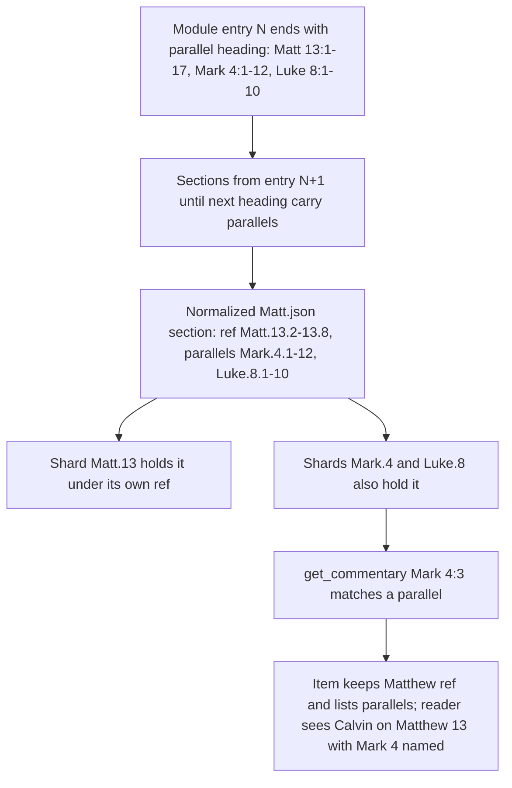
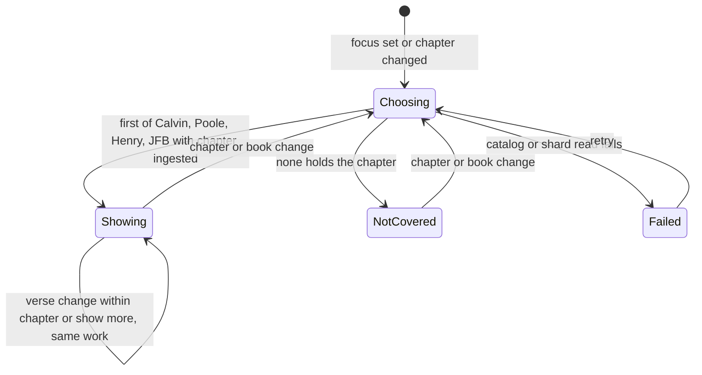
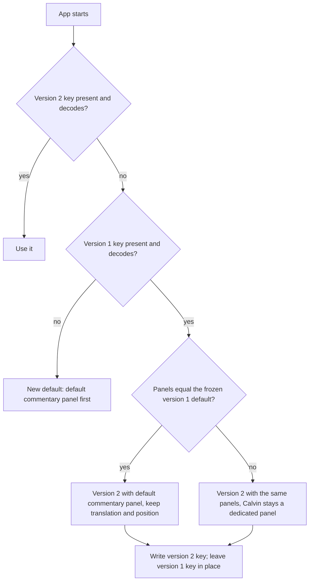

# Widen the Reformed Content - Plan

## Goal Capsule

- **Objective:** A Reformed reader who opens a passage anywhere in the Bible
  finds Reformed commentary beside it, and finds the Three Forms of Unity
  alongside the Westminster Standards when looking up which confession articles
  cite a verse.
- **Means:** Extend the existing pipeline from CrossWire modules, Schaff's
  _Creeds of Christendom_ and EEBO-TCP texts. A default commentary panel picks a
  commentator for each chapter (KTD1, KTD4, KTD6, KTD8, KTD11).
- **Product authority:** The project owner. This plan inherits every
  product-wide rule in
  `docs/plans/2026-11-03-0042-feat-reformed-bible-study-app-plan.md`, cited
  below as "the app plan", and amends that plan's R5 and R30 by removing the
  1689 London Baptist Confession (R2 here). When a requirement and a technical
  decision disagree, the requirement wins on product behavior and the KTD wins
  on mechanism.
- **Stop conditions:**
  - Stop and report if the Henry or JFB modules cannot be read into verse-keyed
    sections (U6). The rest of the plan continues, and merge-order waits on a
    halted PR fall away.
  - Stop and report if Poole's or Owen's text cannot be aligned to verses (U14,
    U15). The rest of the plan continues.
  - A source whose license evidence cannot be quoted from its own page is
    dropped, and work continues (dataset `AGENTS.md`).
  - Stop the whole run if evidence shows a session-settled decision cannot work.
- **Execution profile:** Nine pull requests, grouped and ordered under
  Implementation Units. Every merge to `main` deploys production
  (`docs/operations.md`). A data change reaches readers when its bot "pin
  release" PR merges.
- **Who finishes:** An implementing agent (`ce-work`) builds each group. The
  owner reviews and merges each PR and its lock PR, and checks transcribed
  confession text against the cited scans before merge.
- **Open blockers:** None.

---

## Product Contract

Product Contract preservation: changed R4 (chapters absent from Calvin's source
are deferred), R9 (the fallback chooses by chapter, not book), and R11 with AE5
(an arrangement that still equals the original default counts as default). Repo
research showed that every visitor's device already stores the default
arrangement, so the literal R11 would hide the fallback from nearly every
reader, the owner included. The intent recorded in the Key Decision, "a layout
the reader already chose is theirs", is kept. The Key Decision on confession
English now links R14 instead of R13. Outstanding Questions were resolved in
place into the Planning Contract.

### Summary

Calvin's commentary extends from Romans to all 48 books he wrote on. Then come
Henry and Jamieson-Fausset-Brown, followed by Poole and Owen, each once its
clean source is in hand, and the Heidelberg Catechism, Belgic Confession and
Canons of Dort with proof texts. The default commentary panel shows Calvin where
he wrote on the chapter and otherwise falls back down a set order. Baptist works
are excluded as a standing rule, and Hodge waits for a clean source.

### Problem Frame

The Romans slice is live, and outside Romans it stops short. A reader who opens
Genesis 1 or John 3 gets the text, cross-references and the Greek or Hebrew, but
the commentary panel says the passage is not yet covered. The confession panel
knows only the Westminster Standards, so a continental Reformed reader never
sees the Heidelberg answer that cites the verse.

The app plan deferred both gaps deliberately. Romans was the quality bar for
aligning commentary to verses, and the other confessions lacked clean editions
with proof texts. With the slice shipped, those deferrals are now the largest
gap between what the app offers and the Logos-level depth it aims to give for
free. The owner's own study runs across the whole Bible, so Calvin outside
Romans is the gap the owner feels most.

### Actors

- A1. Reader: a Reformed-leaning lay Bible student using the web app, signed
  out.
- A2. Reader's agent: an AI assistant connected over MCP, or a client of the
  public API.
- A3. Contributor: someone proposing a resource to the open dataset by pull
  request.
- A4. Owner: approves which commentators count, checks license evidence, and
  sends permission requests.

### Key Decisions

- **Baptist works are excluded entirely.** Governs R2. (session-settled:
  user-directed — chosen over the app plan's R5, which listed the 1689
  Confession, and its Outstanding Questions, which named Gill and Spurgeon as
  candidates: the owner holds that Baptists are not Reformed)
- **Commentators come from the owner's named list, not a general rule.** Governs
  R1. (session-settled: user-directed — chosen over a rule admitting any author
  from a Reformed, Presbyterian or Reformed Anglican body with an owner veto,
  and over that rule plus labeled non-Reformed technical aids such as
  Keil-Delitzsch: the owner approves each name)
- **All three pieces sit in one plan, and Calvin ships first.** Governs R3, R18.
  (session-settled: user-directed — chosen over scoping only one of Calvin's
  other books, more commentators, or more confessions in this plan: the owner
  wants all three, and Calvin outside Romans would change the owner's own study
  most)
- **Missing proof texts may come from a second public domain edition.** Governs
  R14, R15. (session-settled: user-approved — chosen over shipping text-only and
  over waiting until one edition carries both: verse lookup is the confession
  panel's main value, and a recorded second source keeps it clean)
- **The default commentary panel falls back from Calvin down a set order.**
  Governs R9. (session-settled: user-approved — chosen over a Calvin-only
  default and over two default commentary panels: one panel stays simple, and
  the reader still sees commentary in the books Calvin skipped)
- **Hodge and Owen stay out of the fallback order.** Calvin covers every book
  they wrote on, so they would never be reached. Governs R9.
- **Calvin's harmonies appear at every parallel passage the source lets us
  identify.** Without this, Mark 4 would show nothing while Matthew 13 shows the
  same comment. Governs R5.
- **A layout the reader already chose is theirs.** One they never changed still
  gets the new default. Governs R11.
- **Confessions read in nineteenth-century public domain English.** Schaff's
  1877 _Creeds of Christendom_ is the text source, as the app plan's KTD13 set.
  Modern church translations are copyrighted, so readers see older wording than
  many know. Governs R14.

### Requirements

**Which works count**

- R1. Commentary ships only from the owner's named list: Calvin, Matthew Poole,
  Matthew Henry, Charles Hodge, John Owen, and Jamieson-Fausset-Brown. A new
  name needs the owner's approval before a contribution can add it.
- R2. No Baptist confession, catechism or commentary ships on any surface. The
  1689 London Baptist Confession leaves planned coverage, and the app, API and
  MCP treat it as an unknown confession.
- R3. Every addition passes the app plan's license gate (its R10 and R11) before
  it ships. A listed commentator with no clean source does not ship and blocks
  nothing else.

**Calvin**

- R4. Calvin's commentary covers all 48 books in his recorded scope, keyed to
  KJV verse numbering, with the same alignment quality as Romans, wherever the
  pinned source holds his text. Chapters the source lacks, Isaiah 49–66, report
  not yet covered until a second source fills them.
- R5. A comment from Calvin's Harmony of the Gospels or Harmony of the Law
  appears at each parallel passage it treats wherever the source identifies the
  passage, and otherwise at the passage the source keys it to.
- R6. In a book Calvin did not write on, a Calvin panel says the book is outside
  his work rather than that the passage is not yet covered.

**More commentators**

- R7. Poole, Henry and Jamieson-Fausset-Brown each cover the whole Bible, Hodge
  covers Romans, 1 and 2 Corinthians and Ephesians, and Owen covers Hebrews.
  Each ships as its own commentary resource carrying author, work, edition and
  license.
- R8. Each commentator ships on its own schedule, as soon as its source clears
  R3.

**Reader panels**

- R9. The default arrangement's commentary panel shows Calvin's comment where
  his commentary holds the current chapter. Otherwise it shows the first of
  Poole, Henry, then Jamieson-Fausset-Brown whose commentary holds that chapter,
  and it names whose comment is showing.
- R10. A reader can add a panel for any one commentator, and that panel stays on
  that commentator in every book.
- R11. An arrangement the reader changed before this work keeps exactly the
  commentary panels it holds. One still identical to the original default
  arrangement counts as the default and gets the R9 panel.
- R12. When no commentator covers the passage, the default commentary panel says
  the passage is not yet covered, per the app plan's R9.

**Agents and the API**

- R13. A request for commentary that names no work returns every shipped
  commentator that covers the passage, each with its attribution, on the API and
  MCP alike.

**Confessions**

- R14. The Heidelberg Catechism, Belgic Confession and Canons of Dort join the
  confession panel, the API and MCP. Each is navigable from a verse to the
  articles citing it and from an article to its proof texts, and each is
  transcribed from one named public domain edition.
- R15. When a confession's text edition lacks proof texts, they may come from a
  second public domain edition, and the confession's attribution names both
  editions.
- R16. A confession with no public domain source for its proof texts ships
  browsable by outline and article. Verse lookup reports that it has no proof
  texts, which is distinct from reporting that no article cites the verse.
- R17. Each confession ships on its own schedule, as soon as it clears R3.

**Delivery**

- R18. Calvin's other books ship before any new commentator or confession. Every
  addition reaches the reader, the API, MCP and the open dataset in the same
  release.

### Key Flows

- F1. Study an Old Testament passage
  - **Trigger:** A1 opens a link to Genesis 1:1 with the default arrangement.
  - **Actors:** A1
  - **Steps:** The commentary panel shows Calvin on Genesis 1:1. The reader
    moves to Proverbs 3:5, where Calvin did not write. The panel switches to the
    first fallback commentator holding Proverbs 3 and names that commentator.
    The reader adds a dedicated Calvin panel, which says Proverbs is outside his
    work.
  - **Outcome:** The reader always knows whose comment they are reading, and the
    default panel is empty only when no listed commentator holds the chapter.
  - **Covered by:** R4, R6, R9, R10, R12
- F2. Add a listed commentator
  - **Trigger:** A3 or A4 finds a public domain edition of Poole.
  - **Actors:** A3, A4
  - **Steps:** The contributor records the source, license and attribution and
    opens a pull request. The license gate runs, and the owner checks the
    evidence before merging. A proposal for an author not on the list is
    declined until the owner approves the name.
  - **Outcome:** Poole appears in the next release in every surface and joins
    the default panel's fallback.
  - **Covered by:** R1, R3, R7, R8, R9

### Acceptance Examples

- AE1. **Covers R4.** Given Calvin's other books have shipped, when a reader
  opens Genesis 1:1, then the commentary panel shows Calvin's comment on that
  verse.
- AE2. **Covers R5.** Given Calvin treats the parable of the sower in his
  Harmony of the Gospels, when a reader opens Mark 4:3 or Luke 8:5, then the
  panel shows that same comment wherever the source identifies the parallel.
- AE3. **Covers R9.** Given Poole has shipped, when a reader with the default
  arrangement opens Proverbs 3:5, then the commentary panel shows Poole's
  comment labeled as Poole's. Given Poole has not shipped but Henry has, then it
  shows Henry's.
- AE4. **Covers R6, R10.** Given a reader added a dedicated Calvin panel, when
  they open Proverbs 3:5, then that panel says Proverbs is outside Calvin's
  work.
- AE5. **Covers R11.** Given a reader saved an arrangement before this work that
  adds or reorders panels around a Calvin panel, when they return after it
  ships, then that panel still shows Calvin and does not fall back. Given a
  reader whose saved arrangement is still the original default, then they get
  the R9 panel.
- AE6. **Covers R2.** Given an agent asks for article 10.1 of the 1689 London
  Baptist Confession, when the call returns, then it reports an unknown
  confession.
- AE7. **Covers R3, R8.** Given Hodge has no source whose license is declared,
  when the release is built, then Hodge is absent and every cleared commentator
  still ships.
- AE8. **Covers R15.** Given the Heidelberg text comes from one public domain
  edition and its proof texts from another, when a reader opens Question 1, then
  its attribution names both editions.
- AE9. **Covers R16.** Given the Canons of Dort ship with no proof-text source,
  when a reader looks up Romans 9:11, then the confession panel says the Canons
  have no proof texts. It does not say that no article cites the verse.

### Success Criteria

- The owner opens any passage in Calvin's 48 books that his source holds and
  finds his comment there with the same alignment quality as Romans.
- Once one whole-Bible commentator has shipped, every chapter of the Bible shows
  Reformed commentary in the default arrangement.
- Every new resource carries a recorded source, license and attribution, and an
  outside developer could still fork the dataset without asking permission.

### Scope Boundaries

- Calvin's Institutes, sermons and letters. This plan covers his commentaries
  only.
- Commentators not on the named list, including Barnes and Keil-Delitzsch, until
  the owner approves them.
- Anything Baptist, including the 1689 Confession, Gill, Spurgeon and Bunyan.
- Modern translations of the confessions.
- Panel layout presets, saved study sets, curated notes and full-text search,
  which remain the app plan's later components.
- Limiting how many commentators an agent receives per call. R13 keeps today's
  behavior, and the agent evals would show whether results grow too long.

**Considered and not built**

- Hiding a commentator from the default panel when the reader also has a
  dedicated panel for that commentator. Seeing the same comment twice is visible
  and harmless. Reader complaints would change this.
- Falling through to the next commentator when Calvin holds the chapter but has
  no comment on the selected verse. Choosing by chapter keeps one voice per
  chapter. Gaps observed in Mark and Luke after the harmony parallels land would
  change this.
- Per-chapter scope, so that a dedicated Calvin panel on Ezekiel 21–48 says
  "outside his work" instead of "not yet covered". It would change the catalog
  shape for one book's tail. Reader confusion would change this.
- Interleaving commentators on the first page of a no-work agent call. Agents
  page with the cursor today. Evals showing agents stop before reaching Henry
  would change this.
- A coverage state for a confession with no proof texts (R16). Every confession
  in this plan has a proof-text source (KTD9), so nothing would produce it. A
  confession that ships without proofs would change this.

**Deferred to Follow-Up Work**

- Calvin on Isaiah 49–66 from CCEL's _Calvin's Commentaries_ volume on Isaiah,
  whose ThML declares public domain. It needs a ThML adapter.
- Hodge, once a source that declares its license or a recorded permission
  exists. CCEL's Ephesians has a blank rights field, and the other three exist
  only as archive.org scans.
- Owen on Hebrews 1–5 and 11–13, which exist only as scans.

### Dependencies / Assumptions

- The pinned CrossWire Calvin module holds the 48 scoped books, Acts included,
  with Isaiah ending at 48:22 and Ezekiel at chapter 20, where Calvin died.
- Henry's and JFB's CrossWire modules declare
  `DistributionLicense=Public Domain` and are built from CCEL texts that also
  declare public domain, so neither needs CCEL permission.
- Poole's and Owen's clean texts are EEBO-TCP transcriptions released under CC0,
  with many illegible-character gaps and seventeenth-century spelling.
- The release stays near 12,500 static files against the build's 18,000-file
  budget.
- More contributed sources raise the stakes of the app plan's open review item
  about MCP excerpts carrying instructions to agents. That item stays separate
  work.

### Outstanding Questions

**Deferred to Planning**

- Whether to edit the app plan's R5 and R30 text. This plan records the
  amendment, and the app plan stays a historical record.

### Sources / Research

- The app plan:
  `docs/plans/2026-11-03-0042-feat-reformed-bible-study-app-plan.md`, especially
  R5, R9, R10, R11, R21, R30, KTD5, KTD7, KTD13, and its Outstanding Questions
  on commentators.
- Calvin ingest, hard-wired to Romans and the New Testament:
  `packages/dataset-tools/src/ingest/calvin.ts`, with the reader in
  `packages/dataset-tools/src/ingest/crosswire-zcom.ts` and the OSIS parser in
  `packages/dataset-tools/src/ingest/osis-text.ts`.
- Calvin's 48-book scope: `dataset/resources/calvin-commentaries/resource.json`.
- Commentary coverage and the search across every catalogued work:
  `packages/core/src/capabilities/commentary.ts`,
  `packages/core/src/capabilities/shared.ts`.
- The default panels and on-device persistence:
  `apps/web/src/panels/arrangement.ts`, `apps/web/src/layout/storage.ts`,
  `apps/web/src/layout/layout-schema.ts`.
- The confession identifier grammar:
  `packages/core/src/confessions/identifiers.ts`.
- Per-chapter shards and the file budget:
  `packages/dataset-tools/src/build/shards.ts`,
  `packages/dataset-tools/src/build/budget.ts`.
- CrossWire module configurations:
  https://crosswire.org/ftpmirror/pub/sword/raw/mods.d/
  (`calvincommentaries.conf`, `mhc.conf`, `jfb.conf`).
- Schaff, _Creeds of Christendom_ vol. 3, CCEL ThML:
  https://ccel.org/ccel/schaff/creeds3.xml
- The Heidelberg Catechism, 1879 edition with proof texts:
  https://en.wikisource.org/wiki/The_Heidelberg_Catechism
- EEBO-TCP Poole volumes A55363 and A55368, and Owen A53678:
  https://github.com/textcreationpartnership

---

## Planning Contract

### Key Technical Decisions

- KTD1. **Calvin's other books come from the module already pinned, and the zCom
  reader learns that module's real layout.** Three defects block the other
  books:
  - An entry longer than 65,535 bytes wraps its 16-bit size, which cuts Genesis
    1:1, Deuteronomy 16:16, Lamentations 5:22 and 1 Corinthians 16:22
    mid-comment. The reader takes an entry's true size from the next indexed
    offset in the same block.
  - In Psalms, Zechariah, Malachi, 1 and 2 Timothy and Titus, every verse slot
    links to one chapter entry. The other verse sections sit unindexed in the
    block after it, and the reader recovers them by scanning to the next indexed
    offset.
  - A chapter-level section, such as the one on Psalm 1, folds into the
    chapter's first verse section as its opening paragraphs. This keeps the
    README rule that no two sections cover the same verse. A separate
    chapter-wide section was rejected because it would match every verse in the
    chapter, so one long Psalm introduction would fill each verse's first result
    page and push the verse's own comment behind "show more". A separate
    introduction field was rejected because it changes the shard and output
    schemas.

  An ingest-time check compares the new Romans output with the locked archive's
  normalized Romans file. A difference caused by KTD2's chapter cap or by
  paragraph breaks is reviewed and accepted in the PR, not treated as a failure.
  Implements R4.

- KTD2. **A section ends before the next section in its book, or at the end of
  its own chapter, whichever comes first.** Today the last section runs to the
  end of the book. That would serve Calvin's Isaiah 48:22 comment at Isaiah 53,
  and let a sparse Mark comment leak into later chapters. The Ezekiel 21:1
  translator's note is dropped, so Ezekiel 21 counts as not ingested. Implements
  R4, R9.
- KTD3. **Harmony parallels are an optional list of pericope ranges on a
  commentary section.** The ranges come from the parallel heading at the end of
  the previous entry, which the parser drops today. "Previous" means previous in
  Calvin's reading order, by block and offset across all books, before entries
  are split by book. Verse-slot order is wrong for the harmonies: Exodus 20:1
  sits in block 6, Deuteronomy 5:1 in block 7 and Leviticus 1:1 in block 80.
  Parallels are taken only inside the two harmonies: from entries in Matthew,
  Mark and Luke, and in Exodus through Deuteronomy, from the heading paragraph
  directly before a pericope's per-book table, and only references into those
  same books. Back-matter scripture indexes and argument headings elsewhere also
  cite other books, and taking them would put a Hebrews comment into a Proverbs
  shard. The heading applies to each section from the next entry up to the
  following heading. The chapter grouping, not the payload writer, adds each
  section to its parallel chapters. It merges sections per book and chapter
  across all of a resource's books, removes duplicates by reference, and keeps
  one canonical order, because the paging cursor counts sections. A parallel
  chapter therefore counts as ingested in the catalog, so the capability reads
  its shard and the default panel picks Calvin there. The commentary capability
  matches a request against a section's own range or any parallel, and returns
  the parallels on the item. Duplicating the section into each book as its own
  section was rejected because it breaks the README overlap rule and hides which
  gospel Calvin keyed it to. A section keyed to Matthew therefore shows at Mark
  4:3 under its own Matthew range, with its Mark and Luke parallels named. The
  field is omitted when empty, so shards for data without parallels stay
  byte-identical and the deploy from the old lock still reproduces (KTD10). The
  README overlap rule applies to a section's own range only. Implements R5.
- KTD4. **Henry and JFB ship as separate resources from their CrossWire zCom4
  modules.** zCom4 differs from zCom in a 12-byte index slot with a 32-bit size.
  The ingest generalizes from Calvin's markup to any OSIS commentary entry. A
  chapter introduction folds into the chapter's first section, as in KTD1, and
  an entry Henry keys to a verse range takes that range. Book introductions are
  left out, and `modifications` records that. Implements R7, R8.
- KTD5. **The default commentary panel is its own panel kind, and one exported
  core function owns R9's order and the choice.** The function takes the catalog
  and a chapter and returns the first work in R9's order whose scope includes
  the chapter's book and whose catalog entry lists that chapter as ingested, or
  none. The web fetch reads the catalog through the same content store before
  choosing, so the panel never waits on the app's own catalog load. The choice
  holds for the chapter, including "show more", whose cursor is bound to one
  work. The panel stays exempt from dropping withdrawn resources, and it can be
  re-added after removal. Its panel id sits outside the `commentary:` prefix, so
  no resource id can collide with it. A `default` pseudo-work in the commentary
  capability was rejected because it would put a non-resource into the public
  resource-id space. Agents get parity instead through ordering: a no-work
  commentary call lists works in R9's order, then the rest by id. Implements R9,
  R10, R12. (session-settled: user-approved — chosen over a Calvin-only default
  and over two default commentary panels: one panel stays simple, and the reader
  still sees commentary in the books Calvin skipped)
- KTD6. **Layout storage moves to version 2 under a new storage key.** The
  version 1 record is read once to migrate and is never deleted. A new key keeps
  an older cached tab from writing version 1 over a version 2 choice. The
  migration decodes with a frozen version 1 schema, so raising the live version
  cannot make old records undecodable. It compares panels in order, on kind and
  resource id only, against a frozen copy of the version 1 default panels, not
  the live default. Translation and reading position carry over in both paths. A
  version 2 record that fails to decode is migrated again from version 1.
  Changes an older open tab writes to the version 1 key after migration are
  accepted as lost. Implements R11.
- KTD7. **Confession article ids stay free of slashes and fit the existing
  routes.**
  - Heidelberg uses `Q<n>`, with Lord's Days as divisions. "HC LD n" resolves to
    that Lord's Day's first question.
  - Belgic uses `Art<n>`.
  - Dort uses `I.1`, `II.1`, `III-IV.1`, `V.1` and `Conclusion`. Typed forms
    such as "CD III/IV 1", "CD 3/4.1" and "CD Conclusion" all resolve to these
    ids. Schaff prints the Rejection of Errors only in Latin, so it gets no ids
    and does not ship.

  The `lbcf` grammar entry and its names are removed, so a 1689 identifier
  parses as an unknown confession. Implements R2, R14.

- KTD8. **The confession sources are chosen by the edition their proofs come
  from.**
  - Heidelberg takes its text from Schaff 1877, which has no proof texts, and
    its proofs per answer from the 1879 Reformed Church edition on Wikisource.
    It follows the Shorter Catechism's precedent of one run per answer.
  - Belgic takes its English from Schaff 1877. Its proofs come from Schaff's own
    scripture notes, printed beside the French column, and attach to the whole
    article.
  - Dort takes its English from Schaff 1877, and the confession's own inline
    citations become its proofs.

  An article-level proof is marked by a new optional field on the proof, omitted
  when unused so the Westminster shards stay byte-identical. The existing label
  field is reserved for the print's clause letter. The confession page shows an
  article-level proof under the article rather than against one clause.
  `source.md` records a spot check of French verse numbering and of 1879
  question numbering against the text. Implements R14, R15. (session-settled:
  user-approved — chosen over shipping text-only and over waiting until one
  edition carries both: verse lookup is the confession panel's main value, and a
  recorded second source keeps it clean)

- KTD9. **No new coverage state ships.** Every confession in KTD8 has proofs, so
  R16's state has nothing to report. A confession that ships with no proofs
  would need a new coverage state, which is additive under the app plan's KTD7,
  plus a third bucket in the confessions panel. Implements R16 by construction.
- KTD10. **Code that changes the content schemas or the release build must
  reproduce the current lock.** Deploy rebuilds the locked archive's normalized
  files with the new code, never re-ingesting sources, and stops before
  deploying if the release id changes, so production stays on its last good
  build. Ingest-only changes cannot break the rebuild. A failed rebuild after a
  lock already carries new fields is undone in this order: revert the lock PR to
  the previous `dataset-*` release, then revert the code. Implements R18.
- KTD11. **Poole and Owen ship from EEBO-TCP's CC0 transcriptions through a TEI
  adapter.** The adapter keys annotations to verses by the text's own chapter
  and verse markers. Each illegible-character gap is kept as a visible mark, not
  silently closed up. Poole's record names the continuators who finished the
  work after Isaiah 58. Owen ships Hebrews 6–10, and the other chapters report
  not yet covered. Implements R7, R8.
- KTD12. **Agent descriptions, evals and the grader follow the corpus.** Tool
  descriptions and discovery text name the corpus generically, not "Calvin and
  Westminster". Two negative evals turn false against production once Calvin and
  Henry ship: "Calvin on Genesis is not covered" and "Henry is not available".
  They become negatives that stay true: Calvin on Revelation is outside his
  work, Spurgeon is not available, and the 1689 Confession is unknown. The
  grader learns the Heidelberg, Belgic and Dort citation forms. Implements R2,
  R13.
- KTD13. **Hodge does not ship in this plan.** No source declares his license.
  Archive.org's "not in copyright" flag carries no license statement, so it
  fails the gate's evidence rule. Implements R3.

### High-Level Technical Design

How a harmony section reaches a parallel passage (KTD3):

The default commentary panel's states (KTD5):

Migrating a stored layout (KTD6):

### Assumptions

- The R11 change was made in pipeline mode without the owner present. Treating
  an arrangement that still equals the original default as default follows the
  recorded intent, and the owner confirms it at PR review.
- An agent asking for Mark 4:3 is better served by Calvin's comment under its
  Matthew range with Mark named as a parallel than by no comment at all.
- The 1879 edition's question numbers match Schaff's 129 questions. The spot
  check in KTD8 tests this, and a mismatch stops that confession's unit.

### System-Wide Impact

- **Agents and API:** Commentary items gain an optional parallels field, which
  is an additive output change. No-work calls now return several commentators,
  each attributed and in R9's order (R13, KTD5). Descriptions change, so the MCP
  snapshot changes.
- **Deploy:** Each data PR deploys code first, then its data when the bot lock
  PR merges (KTD10). The release workflow ingests everything on `main`, so every
  data PR (PR2, PR3, PR4, PR6, PR7, PR8, PR9) merges only after the lock PR of
  the data PR merged before it has merged and its deploy smoke passed. A data PR
  halted by a stop condition drops out of this chain. That keeps Calvin's
  release ahead of Henry's (R18), and keeps two lock PRs from conflicting.
- **Readers' devices:** Every returning reader's layout migrates once (KTD6). An
  older open tab keeps working on the version 1 key.

### Risks & Dependencies

| Risk                                                  | Mitigation                                                                                                            |
| ----------------------------------------------------- | --------------------------------------------------------------------------------------------------------------------- |
| Henry's or JFB's markup defeats the generic parser    | U6 starts by characterizing both modules; the stop condition halts PR4 only                                           |
| TEI alignment for Poole or Owen is unreliable         | U14 measures how many annotations key to a verse before shipping; the stop condition halts PR7 only                   |
| A schema or build change breaks the production deploy | The old-lock rebuild gate on every PR touching schemas or build code (KTD10); a failed rebuild stops before deploying |
| French verse numbering shifts Belgic proofs silently  | The KJV existence check plus the spot check in `source.md` (KTD8)                                                     |
| Sections too large for one result page                | Today's paging returns an oversized section alone and never cuts it; no change                                        |

---

## Implementation Units

| Unit | Title                                       | Key files                                                                                                                            | Depends on |
| ---- | ------------------------------------------- | ------------------------------------------------------------------------------------------------------------------------------------ | ---------- |
| U1   | Confession ids and the 1689 removal         | `packages/core/src/confessions/identifiers.ts`, `packages/core/src/content/schemas.ts`, `apps/web/src/route.ts`                      | none       |
| U2   | zCom reader fixes                           | `packages/dataset-tools/src/ingest/crosswire-zcom.ts`, `packages/dataset-tools/src/ingest/osis-text.ts`                              | none       |
| U3   | Calvin across his books                     | `packages/dataset-tools/src/ingest/calvin.ts`, `dataset/resources/calvin-commentaries/resource.json`                                 | U2         |
| U4   | Descriptions and evals for the wider corpus | `apps/edge/src/mcp-instructions.md`, `evals/agent/negative.eval.ts`                                                                  | U1, U3     |
| U5   | Harmony parallels                           | `packages/core/src/content/schemas.ts`, `packages/dataset-tools/src/build/shards.ts`, `packages/core/src/capabilities/commentary.ts` | U3         |
| U6   | zCom4 and generic OSIS commentary entries   | `packages/dataset-tools/src/ingest/crosswire-zcom.ts`                                                                                | U2         |
| U7   | Henry and Jamieson-Fausset-Brown            | `packages/dataset-tools/src/ingest/`, `dataset/resources/`                                                                           | U6         |
| U8   | Default commentary panel                    | `apps/web/src/panels/`                                                                                                               | none       |
| U9   | Layout storage version 2                    | `apps/web/src/layout/`                                                                                                               | U8         |
| U10  | Heidelberg Catechism                        | `dataset/confessions/hc/`                                                                                                            | U1         |
| U11  | Belgic Confession                           | `dataset/confessions/bc/`                                                                                                            | U1         |
| U12  | Canons of Dort                              | `dataset/confessions/cd/`                                                                                                            | U1         |
| U13  | Confession surfaces beyond Westminster      | `packages/core/src/capabilities/`, `evals/agent/grade.ts`                                                                            | U10        |
| U14  | TEI adapter and Poole                       | `packages/dataset-tools/src/ingest/tei-commentary.ts`, `dataset/resources/`                                                          | none       |
| U15  | Owen on Hebrews                             | `dataset/resources/owen-hebrews/`                                                                                                    | U14        |

### PR1: Confession ids and the 1689 removal

Waits on: none.

### U1. Confession ids and the 1689 removal

- **Goal:** Every Three Forms citation parses to a slash-free id that the API
  and web routes can carry, and 1689 identifiers no longer parse.
- **Requirements:** R2, R14. KTD7.
- **Dependencies:** none.
- **Files:** `packages/core/src/confessions/identifiers.ts`,
  `packages/core/src/content/schemas.ts`, `packages/core/src/site/urls.ts`,
  `apps/web/src/route.ts`, `packages/core/test/confessions/identifiers.test.ts`,
  `packages/core/test/site/urls.test.ts`, `apps/web/test/route.test.ts`
- **Approach:**
  1. Remove `lbcf` from the confession ids, the names table and the parser's doc
     example.
  2. Widen the article id schema for `III-IV.<n>` and `Conclusion`, and add the
     Lord's Day citation form.
  3. Add a web route for the Conclusion, mirroring the existing section and
     question routes.
- **Patterns to follow:** the existing `ROMAN_HEADS` parse and the
  `ConfessionSection` and `ConfessionQuestion` routes.
- **Test scenarios:**
  - "CD III/IV 4", "CD 3/4.4" and "Canons of Dort III-IV.4" parse to `III-IV.4`.
  - "CD Conclusion" parses to `Conclusion`.
  - "HC LD 1" resolves to Heidelberg `Q1`, and "HC LD 32" to the first question
    of Lord's Day 32.
  - "BC Art. 16" and "Belgic Confession 16" parse to `Art16`.
  - Covers AE6. "LBCF 10.1" and "1689 Confession 10.1" return
    `unknown_confession`.
  - `/confessions/cd/III-IV/4` and `/confessions/cd/conclusion` round-trip
    through the route parser and the URL builder.
  - Existing WCF, WLC and WSC forms still parse unchanged.
- **Verification:** The grammar accepts every form above, and the parity cases
  for Westminster still pass.

### PR2: Calvin across his books

Waits on: PR1 merge order only, since U4's 1689 negative eval holds only after
U1. Merge before every other data PR (R18).

### U2. zCom reader fixes

- **Goal:** The zCom reader returns every entry of the pinned Calvin module
  complete and in place.
- **Requirements:** R4. KTD1, KTD2, KTD10.
- **Dependencies:** none.
- **Files:** `packages/dataset-tools/src/ingest/crosswire-zcom.ts`,
  `packages/dataset-tools/src/ingest/osis-text.ts`,
  `packages/dataset-tools/test/ingest/crosswire-zcom.test.ts`,
  `packages/dataset-tools/test/ingest/osis-text.test.ts`,
  `packages/dataset-tools/test/fixtures/calvin-romans-sample/`
- **Approach:**
  1. Derive each entry's true size from the next indexed offset in its block
     (KTD1).
  2. Recover unindexed sections after a linked chapter entry by scanning to the
     next indexed offset, then split on section starts.
  3. Fold a chapter-level section into the chapter's first verse section.
  4. Treat a self-closing `
` as a paragraph break.
  5. Cap each section at the end of its chapter (KTD2).
- **Execution note:** Before changing the reader, set up the ingest-time
  comparison against the locked archive's normalized Romans file (KTD1), and
  review any Romans difference in the PR.
- **Patterns to follow:** the synthetic module builder in
  `crosswire-zcom.test.ts`. Extend it to an Old Testament variant.
- **Test scenarios:**
  - An entry whose stated size wrapped past 65,535 bytes reads to the next
    entry's offset, and its section closes.
  - A chapter whose verse slots all link to one entry yields every verse section
    found after it in the block, each keyed to its own verse.
  - A chapter section on Psalm 1 becomes the opening paragraphs of the Psalm 1:1
    section, and no two sections overlap.
  - The last section of a chapter stops at that chapter's last verse when the
    next section is in a later chapter.
  - Romans differs from the locked archive's normalized copy only where KTD2's
    chapter cap or a paragraph break applies.
  - An entry whose own reference disagrees with its slot is still reported, not
    silently placed.
- **Verification:** Every scoped book reads with no misplaced-entry failures,
  and the Romans comparison shows only reviewed differences.

### U3. Calvin across his books

- **Goal:** Calvin's commentary is ingested for every chapter the module holds
  in all 48 scoped books.
- **Requirements:** R4, R6, R18. KTD1, KTD2.
- **Dependencies:** U2.
- **Files:** `packages/dataset-tools/src/ingest/calvin.ts`,
  `dataset/resources/calvin-commentaries/resource.json`, `dataset/README.md`,
  `packages/dataset-tools/test/ingest/calvin.test.ts`,
  `packages/dataset-tools/test/build/release.test.ts`
- **Approach:**
  1. Read both testaments, and write one normalized book per scoped book.
  2. Drop the Ezekiel 21:1 translator's note.
  3. Make the record's `edition` and `attribution` book-neutral, naming the
     Calvin Translation Society translators collectively.
  4. Update `modifications` to describe the range and folding rules.
  5. Update the README's description of section ranges.
- **Test scenarios:**
  - Covers AE1. Genesis 1:1 yields Calvin's section on Genesis 1:1 with its full
    text.
  - Isaiah 49 and Ezekiel 21 are not ingested, and Isaiah 48 ends at 48:22.
  - Acts is ingested although the module's About list omits it.
  - Covers AE4. A catalog built from the release reports Proverbs as outside
    Calvin's work.
  - The attribution text names no single book.
- **Verification:** `pnpm dataset:validate` passes, the release build stays
  under the file budget, and about 800 Calvin chapter shards are produced.

### U4. Descriptions and evals for the wider corpus

- **Goal:** Agent-facing text and the evals stay true once Calvin's other books
  and later commentators ship.
- **Requirements:** R2, R13. KTD12.
- **Dependencies:** U1, U3.
- **Files:** `apps/edge/src/mcp.ts`, `apps/edge/src/mcp-instructions.md`,
  `apps/edge/src/discovery.ts`, `packages/core/src/capabilities/commentary.ts`,
  `apps/edge/test/__snapshots__/mcp.test.ts.snap`,
  `evals/agent/negative.eval.ts`, `evals/README.md`
- **Approach:** Describe the corpus generically in tool and discovery text, and
  swap the two negative evals for the ones KTD12 names.
- **Test scenarios:**
  - The MCP snapshot shows the new descriptions, and discovery files no longer
    name only Calvin and Westminster.
  - The Spurgeon, Revelation and 1689 negatives hold in process.
- **Verification:** Edge tests pass with the updated snapshot.

### PR3: Harmony parallels

Waits on: PR2, needed before start, since it builds on U2's parser and U3's
ingest. The lock rule in System-Wide Impact applies.

### U5. Harmony parallels

- **Goal:** Calvin's harmony comments show at each parallel pericope in the
  other gospels and in Exodus through Deuteronomy.
- **Requirements:** R5, R13. KTD3, KTD10.
- **Dependencies:** U3.
- **Files:** `packages/dataset-tools/src/ingest/osis-text.ts`,
  `packages/dataset-tools/src/ingest/crosswire-zcom.ts`,
  `packages/core/src/content/schemas.ts`,
  `packages/dataset-tools/src/build/shards.ts`,
  `packages/core/src/capabilities/commentary.ts`,
  `apps/web/src/panels/commentary/index.ts`, `apps/edge/src/mcp.ts`,
  `apps/edge/test/mcp.test.ts`, `dataset/README.md`,
  `packages/dataset-tools/test/ingest/osis-text.test.ts`,
  `packages/dataset-tools/test/build/release.test.ts`,
  `packages/core/test/capabilities/commentary.test.ts`,
  `tests/parity/cases.json`
- **Approach:**
  1. Capture the parallel heading that trails an entry, and apply it to the
     sections from the next entry in reading order up to the following heading
     (KTD3).
  2. Cap each harmony section at its pericope's end in its own book.
  3. Add the optional parallels field, omitted when empty.
  4. Add sections to their parallel chapters in the chapter grouping, merged
     with each chapter's own sections (KTD3).
  5. Match requests and set coverage against a section's own range or any
     parallel.
  6. Show the section's own range with its parallels named in the web panel and
     in the MCP text form of commentary results.
- **Test scenarios:**
  - Covers AE2. Mark 4:3 and Luke 8:5 return Calvin's section on Matthew 13 as
    covered, with Mark 4:1-12 and Luke 8:1-10 listed as parallels.
  - Sections in Hebrews, 1 Peter and Acts get no parallels, although their
    trailing back-matter cites other books, and no Proverbs, Judges or Psalms
    chapter becomes ingested for Calvin.
  - The MCP text form for Mark 4:3 names the Mark and Luke parallels under the
    Matthew heading.
  - Mark 4:30 returns the section for its own pericope, not the sower's.
  - No Matthew 13 section appears in a Mark 5 request.
  - A section with no parallels serializes without the field, and the current
    lock's archive rebuilds to its release id.
  - A Mark chapter holding both a Mark-keyed section and a Matthew-keyed
    parallel keeps both, in canonical order.
  - A Harmony of the Law section whose heading names a Deuteronomy parallel also
    returns at that Deuteronomy passage, keeping its own range.
  - The catalog lists Mark 4 as ingested for Calvin.
  - The parity case for Mark 4:3 returns the same item in process, over the API
    and over MCP.
- **Verification:** Parity passes, and the old locked archive still rebuilds to
  its release id.

### PR4: Henry and Jamieson-Fausset-Brown

Waits on: PR2, needed before start, since U6 builds on U2's reader. PR3 merge
order only, since both edit the zCom reader and the OSIS parser. The lock rule
in System-Wide Impact applies.

### U6. zCom4 and generic OSIS commentary entries

- **Goal:** The reader ingests CrossWire zCom4 commentary modules whose entries
  are not shaped like Calvin's.
- **Requirements:** R7. KTD4.
- **Dependencies:** U2.
- **Files:** `packages/dataset-tools/src/ingest/crosswire-zcom.ts`,
  `packages/dataset-tools/src/ingest/osis-text.ts`,
  `packages/dataset-tools/test/ingest/crosswire-zcom.test.ts`
- **Approach:**
  1. Characterize both pinned modules first: slot width, verse-0 entries, and
     range entries.
  2. Support the 12-byte zCom4 slot.
  3. Take a section's reference from its slot when the entry carries no section
     marker.
  4. Fold chapter introductions into the chapter's first section, as KTD4
     directs.
- **Execution note:** Start by decoding real entries from both modules into a
  short characterization note in the test fixtures. If they cannot become
  verse-keyed sections, stop PR4 and report.
- **Test scenarios:**
  - A synthetic zCom4 module with a 32-bit size larger than 65,535 reads in
    full.
  - A Henry-style entry keyed "Verses 1-12" becomes one section covering 1–12.
  - A chapter introduction at verse 0 becomes the opening of the chapter's first
    section.
  - A book introduction is left out.
  - The Romans comparison against the locked archive shows no new differences.
- **Verification:** Both modules decode into sections that tile each chapter
  without overlap.

### U7. Henry and Jamieson-Fausset-Brown

- **Goal:** Henry and JFB ship as commentary resources across the whole Bible.
- **Requirements:** R1, R3, R7, R8, R9, R13. KTD4.
- **Dependencies:** U6.
- **Files:** `packages/dataset-tools/src/ingest/henry.ts`,
  `packages/dataset-tools/src/ingest/jfb.ts`,
  `packages/dataset-tools/src/cli.ts`,
  `dataset/resources/matthew-henry/resource.json`,
  `dataset/resources/jamieson-fausset-brown/resource.json`,
  `dataset/REUSE.toml`, `dataset/README.md`,
  `packages/dataset-tools/test/ingest/henry.test.ts`,
  `packages/dataset-tools/test/ingest/jfb.test.ts`,
  `packages/core/test/capabilities/commentary.test.ts`,
  `tests/parity/cases.json`
- **Approach:**
  1. Pin both modules by hash.
  2. Quote `DistributionLicense=Public Domain` and the CCEL rights field as
     evidence.
  3. Register both ingests.
  4. Update the core commentary test that expects only Calvin when no work is
     named.
- **Test scenarios:**
  - Proverbs 3:5 returns Henry's and JFB's sections, each carrying its own
    author, work, edition and license.
  - Covers AE7. A no-work request on Ephesians 1:1 lists Calvin, Henry and JFB
    as covered, and Hodge does not appear.
  - The parity case for a no-work request on Proverbs 3:5 matches across
    surfaces.
- **Verification:** `pnpm dataset:validate` passes, and the release stays under
  the file budget.

### PR5: Default commentary panel

Waits on: PR3 merge order only, since both edit the web commentary panel and the
core commentary capability. The panel works with or without Henry and JFB in the
catalog.

### U8. Default commentary panel

- **Goal:** A first-time reader's commentary panel shows Calvin where he holds
  the chapter, and otherwise the first fallback commentator who does, named.
- **Requirements:** R9, R10, R12. KTD5.
- **Dependencies:** none.
- **Files:** `apps/web/src/panels/panel.ts`,
  `apps/web/src/panels/arrangement.ts`,
  `apps/web/src/panels/commentary/index.ts`, `apps/web/src/panels/context.ts`,
  `apps/web/src/layout/layout-update.ts`, `apps/web/src/view.ts`,
  `packages/core/src/capabilities/default-commentary.ts`,
  `packages/core/src/capabilities/commentary.ts`,
  `packages/core/src/capabilities/index.ts`,
  `packages/core/test/capabilities/default-commentary.test.ts`,
  `packages/core/test/capabilities/commentary.test.ts`,
  `apps/web/test/panels.scene.test.ts`, `apps/web/test/fixture.ts`
- **Approach:**
  1. Add the default commentary panel kind, and make it first in the default
     arrangement.
  2. Add the exported core choice function (KTD5), call it inside the fetch
     after reading the catalog, and carry the chosen work in the panel's result
     so its title and footer name it.
  3. Sort no-work commentary results in the capability by the same order.
  4. Keep the choice across "show more", and re-choose on a chapter change.
  5. Exempt the panel from dropping unavailable resources, and offer it among
     the panels a reader can add.
- **Test scenarios:**
  - Covers AE1. Genesis 1 in the default panel shows Calvin, titled with his
    name.
  - Covers AE3. Proverbs 3 shows Henry when Poole is absent, and Poole when the
    fixture includes Poole.
  - Isaiah 53 falls back past Calvin, because his chapter is not ingested.
  - Moving from Genesis 1 to Proverbs 3 re-chooses, while moving from verse 1 to
    verse 5 keeps the choice.
  - "Show more" continues with the same commentator.
  - Covers AE4. A dedicated Calvin panel added beside it says Proverbs is
    outside Calvin's work.
  - With no commentator holding the chapter, the panel says the passage is not
    yet covered (R12).
  - A failed catalog read leaves the panel in a retryable error state.
  - A reader who removes the default panel can add it back.
  - The core choice function returns none for a chapter no commentator holds,
    and skips a withdrawn commentator.
- **Verification:** The scene tests pass against fixtures with and without
  Henry.

### U9. Layout storage version 2

- **Goal:** Returning readers migrate once, keeping any arrangement they changed
  and gaining the default panel if they never changed it.
- **Requirements:** R11. KTD6.
- **Dependencies:** U8.
- **Files:** `apps/web/src/layout/layout-schema.ts`,
  `apps/web/src/layout/storage.ts`, `apps/web/test/layout.story.test.ts`
- **Approach:** Write version 2 under its new key. Decode the old key with the
  frozen version 1 schema whenever version 2 is absent or undecodable, and map
  it as the migration diagram shows (KTD6).
- **Test scenarios:**
  - Covers AE5. A version 1 record equal to the old default, with a non-default
    translation and a saved position, migrates to the default commentary panel
    with both intact.
  - Covers AE5. A version 1 record with panels reordered or added keeps its
    panels in order, Calvin as a dedicated panel, with translation and position
    intact.
  - A version 2 record is read in preference to a version 1 record.
  - The version 1 key is still present after migration.
  - An undecodable version 2 record is migrated again from version 1, which
    stays untouched.
- **Verification:** The layout stories pass, including the migration seeds.

### PR6: Heidelberg Catechism

Waits on: PR4 merge order only, since both edit the core capability fixture and
the evals. PR5 merge order only, since both edit the web panel scenes. The lock
rule in System-Wide Impact applies.

### U10. Heidelberg Catechism

- **Goal:** The Heidelberg Catechism ships with a proof list on every answer
  that has one in the 1879 edition.
- **Requirements:** R3, R14, R15, R17. KTD7, KTD8.
- **Dependencies:** U1.
- **Files:** `dataset/confessions/hc/confession.json`,
  `dataset/confessions/hc/source.md`, `dataset/resources/hc/resource.json`,
  `dataset/REUSE.toml`, `packages/core/test/capabilities/fixture.ts`,
  `packages/core/test/capabilities/confessions.test.ts`
- **Approach:**
  1. Extract the 129 questions and 52 Lord's Days from Schaff's ThML.
  2. Join the proofs from the 1879 edition by question number after the spot
     check (KTD8).
  3. Name both editions in `edition` and `attribution`.
  4. Replace the test fixture's synthetic `hc` with the real record.
- **Execution note:** Transcription is content work. The owner checks each
  Lord's Day against the scans before merge.
- **Test scenarios:**
  - Covers AE8. Question 1's attribution names Schaff 1877 and the 1879 edition.
  - Romans 8:28 lookup returns Heidelberg Question 1 among the citing articles,
    if the 1879 proofs cite it.
  - The outline lists 52 Lord's Days and 129 questions.
  - A proof reference absent from KJV versification fails the gate.
- **Verification:** The gate passes, and the outline counts match the print.

### U13. Confession surfaces beyond Westminster

- **Goal:** Descriptions, the evals grader and the confessions panel handle
  confessions beyond Westminster.
- **Requirements:** R14. KTD7, KTD12.
- **Dependencies:** U10.
- **Files:**
  `packages/core/src/capabilities/confession-articles-for-passage.ts`,
  `packages/core/src/capabilities/confession-article.ts`,
  `packages/core/src/capabilities/confession-outline.ts`,
  `evals/agent/grade.ts`, `apps/edge/test/__snapshots__/mcp.test.ts.snap`,
  `apps/web/test/panels.scene.test.ts`, `tests/parity/cases.json`
- **Approach:**
  1. Describe the confessions generically in the capability descriptions, so
     later confessions need no description change.
  2. Teach the grader the Heidelberg, Belgic and Dort citation forms.
- **Test scenarios:**
  - The confessions panel on Romans 8:28 groups articles from every confession
    that cites the verse.
  - The grader accepts "HC Q1", "BC Art. 1" and "CD III-IV.1" citations.
  - The parity case for Heidelberg Question 1 matches across surfaces.
- **Verification:** Web scenes, edge tests and parity pass.

### PR8: Belgic Confession

Waits on: PR6 merge order only, since both edit `dataset/REUSE.toml` and the
confession fixtures. The lock rule in System-Wide Impact applies.

### U11. Belgic Confession

- **Goal:** The Belgic Confession ships with article-level proofs from Schaff's
  notes.
- **Requirements:** R3, R14, R17. KTD8.
- **Dependencies:** U1.
- **Files:** `apps/web/src/confession-page/index.ts`,
  `dataset/confessions/bc/confession.json`, `dataset/confessions/bc/source.md`,
  `dataset/resources/bc/resource.json`, `dataset/REUSE.toml`,
  `dataset/README.md`, `packages/core/src/content/schemas.ts`,
  `packages/dataset-tools/test/build/release.test.ts`
- **Approach:** Extract the 37 English articles, attach each article's noted
  references as one article-level proof (KTD8), and record the French-numbering
  spot check. Add the article-level proof field to the confession schema, render
  it under its article on the confession page, and document it in the README's
  proof-text section.
- **Execution note:** The owner checks the text against the scan before merge.
- **Test scenarios:**
  - Article 1's proof lists Ephesians 4:5 and Deuteronomy 6:4, among others, and
    is marked article-level.
  - Westminster confession shards are byte-identical with the new field in the
    schema.
  - A Psalm reference spot-checked against French numbering lands on its KJV
    verse.
  - A Belgic article page shows its proof list after the article text.
  - The outline lists 37 articles.
- **Verification:** The gate passes with every reference resolving in KJV
  versification.

### PR9: Canons of Dort

Waits on: PR1, needed before start, since Dort's ids must exist before
transcription. PR8 merge order only, since both edit `dataset/REUSE.toml` and
the confession schema's users. The lock rule in System-Wide Impact applies.

### U12. Canons of Dort

- **Goal:** The Canons of Dort ship with their own inline citations as proofs.
- **Requirements:** R3, R14, R17. KTD7, KTD8.
- **Dependencies:** U1.
- **Files:** `dataset/confessions/cd/confession.json`,
  `dataset/confessions/cd/source.md`, `dataset/resources/cd/resource.json`,
  `dataset/REUSE.toml`
- **Approach:** Extract the heads, articles and the Conclusion under KTD7's ids.
  Each inline citation becomes a proof on the clause that carries it. Record in
  `modifications` and `source.md` that the Rejection of Errors is left out
  because Schaff prints it only in Latin.
- **Execution note:** The owner checks the text against the scan before merge.
- **Test scenarios:**
  - `III-IV.1` reads back as the first article of the combined head.
  - Romans 3:19 lookup returns the Dort article that cites it.
  - The Conclusion is reachable by its id and listed in the outline.
- **Verification:** The gate passes, and the outline matches Schaff's structure.

### PR7: Poole and Owen

Waits on: PR4 merge order only, since both edit the ingest registry,
`dataset/REUSE.toml`, the parity cases and the core commentary test. PR9 merge
order only, since both edit `dataset/REUSE.toml`. The lock rule in System-Wide
Impact applies.

### U14. TEI adapter and Poole

- **Goal:** Poole's Annotations ship across the whole Bible from EEBO-TCP's CC0
  text.
- **Requirements:** R1, R3, R7, R8, R9. KTD11.
- **Dependencies:** none.
- **Files:** `packages/dataset-tools/src/ingest/tei-commentary.ts`,
  `packages/dataset-tools/src/ingest/poole.ts`,
  `packages/dataset-tools/src/ingest/download.ts`,
  `packages/dataset-tools/src/cli.ts`,
  `dataset/resources/poole-annotations/resource.json`, `dataset/REUSE.toml`,
  `dataset/LICENSES/CC0-1.0.txt`,
  `packages/dataset-tools/test/ingest/tei-commentary.test.ts`,
  `packages/dataset-tools/test/fixtures/poole-sample/`,
  `packages/core/test/capabilities/commentary.test.ts`,
  `tests/parity/cases.json`
- **Approach:**
  1. Pin both volumes' TEI files by hash. Raw GitHub is already an approved
     host.
  2. Parse with document type definitions disabled, as the app plan's KTD19
     requires.
  3. Key annotations by the text's chapter and verse markers.
  4. Keep each gap as a visible mark.
  5. Name Poole and his continuators in the record.
- **Execution note:** Measure what share of annotations key cleanly to a verse
  before writing the record. If the alignment cannot tile chapters without
  overlap, stop PR7 and report.
- **Test scenarios:**
  - A fixture annotation headed with its own verse marker becomes a section
    keyed to that verse.
  - An illegible-character gap appears in the text as a visible mark.
  - A document type definition entity is not expanded.
  - A no-work request on Proverbs 3:5 lists Poole before whichever of Henry and
    JFB have shipped (KTD5).
- **Verification:** The gate passes, the release stays under the file budget,
  and chapters tile without overlap.

### U15. Owen on Hebrews

- **Goal:** Owen's exposition of Hebrews 6–10 ships through the TEI adapter.
- **Requirements:** R1, R3, R7, R8. KTD11.
- **Dependencies:** U14.
- **Files:** `packages/dataset-tools/src/ingest/owen.ts`,
  `packages/dataset-tools/src/cli.ts`,
  `dataset/resources/owen-hebrews/resource.json`, `dataset/REUSE.toml`,
  `packages/dataset-tools/test/ingest/owen.test.ts`,
  `packages/core/test/capabilities/commentary.test.ts`
- **Approach:** Ingest A53678 with scope Hebrews, so chapters 1–5 and 11–13
  report not yet covered.
- **Test scenarios:**
  - Hebrews 6:4 returns Owen's section.
  - Hebrews 1:1 reports Owen as not yet covered, and Romans 1:1 reports him
    outside his work.
- **Verification:** The gate passes.

---

## Verification Contract

| Gate             | Command                                                              | Applies to                                                                                                                        | Proves                                                |
| ---------------- | -------------------------------------------------------------------- | --------------------------------------------------------------------------------------------------------------------------------- | ----------------------------------------------------- |
| Format           | `pnpm format:check`                                                  | every PR                                                                                                                          | oxfmt formatting                                      |
| Lint             | `pnpm lint`                                                          | every PR                                                                                                                          | oxlint with type-aware rules                          |
| Types            | `pnpm typecheck`                                                     | every PR                                                                                                                          | TypeScript through `effect-tsgo`                      |
| Tests            | `pnpm test`                                                          | every PR                                                                                                                          | unit, story, scene and in-process Worker tests        |
| License gate     | `pnpm dataset:validate --json`                                       | PR2, PR4, PR6, PR7, PR8, PR9                                                                                                      | R3, every new record's evidence                       |
| Release build    | `pnpm dataset:ingest all` then `pnpm dataset:build`                  | PR2, PR3, PR4, PR6, PR7, PR8, PR9                                                                                                 | file budget, catalog, archive                         |
| Old lock rebuild | `pnpm dataset:from-archive` on the current lock's downloaded archive | every PR touching `packages/core/src/content/`, `packages/core/src/shards/` or `packages/dataset-tools/src/build/`: PR1, PR3, PR8 | KTD10: the deploy still reproduces the locked release |
| Parity           | `pnpm test:parity`                                                   | PR3, PR4, PR5, PR6, PR7, PR8, PR9                                                                                                 | R13 identical behavior across surfaces                |
| Agent evals      | `pnpm evals`                                                         | after PR4 and PR9, with a model key                                                                                               | KTD12 negatives and new citations                     |

---

## Definition of Done

- Every unit's verification holds, and every gate above passes for the PR that
  introduces it.
- After each data PR's lock PR merges, the deploy smoke in `docs/operations.md`
  passes, and Genesis 1:1 shows Calvin on the live site.
- No resource ships without quoted license evidence from its own source page.
- Tool descriptions, discovery files and the evals grader match the shipped
  corpus.
- No abandoned experiments, dead code or unused dependencies remain in the diff.

---

## Deferred / Open Questions

These entries are review items left for the author. They do not block
implementation.

### From 2026-11-04 review

- **AE9 describes the Canons of Dort shipping without proof texts, which this
  plan never does** — Product Contract, Acceptance Examples (P2, coherence,
  confidence 75)

  The Canons ship with their own inline citations as proofs, and no confession
  in this plan lacks proofs, so this example can never be exercised as written.
  An implementer reading it as an acceptance criterion might build the "no proof
  texts" state that the plan rules out.

  Change: reword AE9 to a hypothetical confession shipped without a proof-text
  source, and note that this plan does not exercise it.

- **R7 says Owen covers Hebrews, but only Hebrews 6–10 has a clean source** —
  Product Contract, Requirements (P3, coherence, confidence 75)

  Whoever checks R7 could treat Hebrews 1–5 and 11–13 as required, or their
  absence as a defect, while the plan ships only chapters 6–10.

  Change: have R7 say Owen covers Hebrews 6–10, with the other chapters
  reporting not yet covered until a clean source exists.

- **R4 names Isaiah 49–66 as the chapters Calvin's source lacks, but not Ezekiel
  21–48** — Product Contract, Requirements (P3, coherence, confidence 75)

  A reader checking R4 would not expect Ezekiel 21 onward to report not yet
  covered. Calvin died before writing on those chapters, so no second source
  will fill them.

  Change: add to R4 that Ezekiel 21–48, which Calvin never wrote, also reports
  not yet covered.
