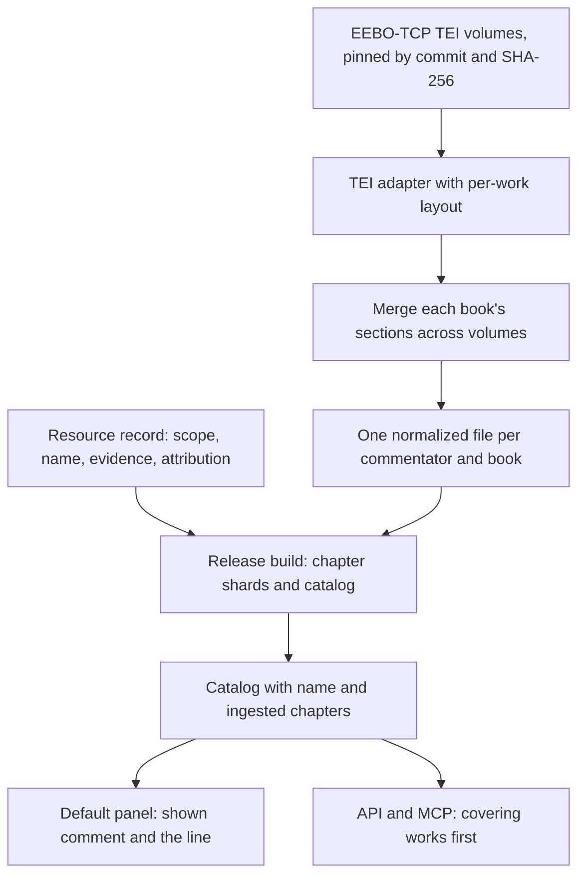
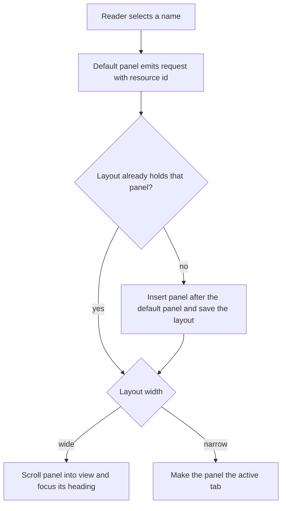

# Scottish and Puritan Commentaries - Plan

## Goal Capsule

- **Objective:** A Reformed reader studying a single book finds the classic
  Scottish and Puritan exposition of that book one click from the default
  commentary panel. The Westminster divines' annotations sit beside every
  chapter of the Bible.
- **Means:** Sixteen commentators added from the Text Creation Partnership's CC0
  EEBO-TCP transcriptions. The adapter that ships Poole and Owen reads them.
- **Product authority:** The project owner. This plan inherits every
  product-wide rule in
  `docs/plans/2026-11-03-0042-feat-reformed-bible-study-app-plan.md` ("the app
  plan") and in `docs/plans/2026-11-04-0307-feat-widen-reformed-content-plan.md`
  ("the widen plan"). It amends the widen plan's R1 by adding the names in R1
  here. It also amends the 18,000-file build budget set under the app plan's
  KTD2 (R16 here). The other content areas found in the survey are not active
  scope (see How This Work Fits Together).
- **Stop conditions:**
  - A work that cannot be aligned to verses is dropped and reported (R3). The
    rest of its PR continues.
  - A source whose repository page does not carry a CC0 statement that can be
    quoted exactly is dropped and reported (dataset `AGENTS.md`).
  - Stop the whole run if evidence shows a session-settled decision cannot work.
- **Execution profile:** Five pull requests, grouped and ordered under
  Implementation Units. Every merge to `main` deploys production
  (`docs/operations.md`). A data PR's content reaches readers when its lock PR
  merges.
- **Who finishes:** An implementing agent builds each group. The owner reviews
  and merges each PR and its lock PR, and spot-checks verse alignment for each
  new work before merge (Success Criteria).
- **Open blockers:** None.

---

## Product Contract

Product Contract preservation: restructured, no scope change. Corrected three
statements that research showed were inaccurate: the long-s Key Decision
(replacing it is new adapter work, not existing behavior), the budget citation
(the 18,000 cap sits under the app plan's KTD2), and the Problem Frame's count
of whole-Bible works.

### Summary

Sixteen Reformed commentators join the app from EEBO-TCP's CC0 transcriptions:

- Three annotation sets: the Westminster Annotations and Diodati on the whole
  Bible, and Arthur Jackson on much of the Old Testament.
- Book-length expositions by Dickson, Hutcheson, Fergusson, Durham, Nisbet,
  Leighton, Burroughs, Hall, Sibbes, Manton, Perkins, Gouge and Junius.

Each commentator has one panel covering all their works. The default commentary
panel keeps its order and gains a line naming every other commentator on the
chapter, and selecting a name adds that commentator's panel. The build's file
budget rises to the Cloudflare Workers Paid limit the project already pays for.

### Problem Frame

Outside Calvin, the commentary shelf holds three whole-Bible works, Poole, Henry
and Jamieson-Fausset-Brown, plus Owen on Hebrews 6–10. The tradition's
book-length expositions are absent. These include Hutcheson on John, Dickson on
the Epistles, Durham on Revelation and Leighton on 1 Peter. A Reformed reader
working through one book cannot reach the treatment their tradition regards as
standard. The Westminster Annotations, the nearest thing to a Reformed study
Bible, are also missing.

The content survey of 2026-11-04 (`docs/research/2026-11-04-content-survey/`)
showed that availability is not the obstacle. Most of these works exist as
clean, CC0-licensed TEI on GitHub, in the format the app already ingests for
Poole and Owen. The survey's earlier "not in EEBO-TCP" verdicts came from the
TCP catalogue file, which is incomplete. A direct GitHub check found the
Westminster Annotations (A36467).

A second obstacle turned out to be self-imposed. The build caps the release at
18,000 files, which the app plan sized for Cloudflare's free plan. The project
already pays for Workers Paid, whose limit is 100,000 files per Worker version.
Under the old cap, each whole-Bible work cost 1,189 files of a remaining 5,500,
and the budget, not value, decided which works could ship.

### Actors

- A1. Reader: a Reformed-leaning Bible student using the web app, signed out.
- A2. Reader's agent: an AI assistant connected over MCP, or a client of the
  public API.
- A3. Owner: approves commentators by name and checks license evidence and verse
  alignment before merge.

### Key Decisions

- **The new commentators are approved by name.** Governs R1. (session-settled:
  user-directed — chosen from survey groups the owner could include or leave
  out: Scottish Presbyterians, English Puritans, Leighton, Gouge, the
  Westminster Annotations, Nisbet, Hall, Junius, Durham's Isaiah 53, Jackson and
  Diodati; the widen plan requires the owner to approve each name)
- **Readers discover the new works through a line in the default panel.**
  Governs R11, R12, R13. (session-settled: user-approved — chosen over ranking
  single-book specialists ahead of the whole-Bible works, a switcher on the
  default panel, and dedicated panels only: single-book works never reach the
  default panel, so without the line a reader must already know Hutcheson wrote
  on John)
- **The default panel's order does not change.** Governs R10. (session-settled:
  user-approved — chosen over placing the Westminster Annotations second after
  Calvin: the default stays one familiar voice per chapter, and the line reaches
  everything else)
- **Selecting a name adds a lasting panel.** Governs R12. (session-settled:
  user-approved — chosen over swapping the default panel for one chapter and
  over a temporary panel: it reuses Add panel's behavior and adds no new panel
  state)
- **The file budget follows the plan the project pays for.** Governs R16.
  (session-settled: user-directed — the owner confirmed the account is on
  Workers Paid, so the free-plan budget was the wrong constraint)
- **Old texts read as printed.** Spelling stays as printed and illegible gaps
  stay visible, as for Poole and Owen (widen plan KTD11). The long-s becomes s,
  which is new: Poole's and Owen's sources contain none. Governs R6.
- **Agents keep today's behavior.** A request that names no work already leads
  with the names of every covering commentator, so agents can discover the new
  works without an API change. Governs R14.

### Requirements

**Commentators and sources**

- R1. The owner's named list of commentators (widen plan R1) gains: the
  Westminster Annotations (1645), Giovanni Diodati, Arthur Jackson, David
  Dickson, George Hutcheson, James Fergusson, James Durham, Alexander Nisbet,
  Robert Leighton, Jeremiah Burroughs, Thomas Hall, Richard Sibbes, Thomas
  Manton, William Perkins, William Gouge and Franciscus Junius.
- R2. Each commentator ships the works in the coverage table below, from the
  EEBO-TCP transcription named there. It passes the app plan's license gate with
  the Phase I or Phase II CC0 statement quoted from that work's own repository
  page.
- R3. Each work ships on its own schedule. A work that cannot be aligned to
  verses is dropped and blocks nothing else.
- R4. Comments are keyed to the verses the source marks. A comment the source
  attaches to a passage, such as one of Durham's lectures on Revelation, appears
  at every verse of that passage.
- R5. Where a source's verse label disagrees with the KJV verse its text quotes,
  the comment is keyed to the quoted verse. Sibbes on Hosea 14 has such labels.
- R6. Text reads as printed: original spelling kept, the long-s shown as s, and
  each illegible gap shown as a visible mark.
- R7. Each work's attribution names its author and any translator, editor or
  continuator its title page or catalogue record names. For example, Ralph
  Cudworth wrote chapter 6 of the Perkins Galatians volume.
- R8. Owen on Hebrews 1–5 and 11–13 and Manton on James are re-checked directly
  on GitHub, since the catalogue that ruled them out is incomplete. A clean CC0
  transcription that turns up joins under its already-approved author.

| Commentator             | Works and coverage                                                 | EEBO-TCP                               |
| ----------------------- | ------------------------------------------------------------------ | -------------------------------------- |
| Westminster Annotations | Whole Bible (1645)                                                 | A36467                                 |
| Diodati                 | Pious Annotations, whole Bible (1643 English)                      | A36033                                 |
| Arthur Jackson          | Annotations, Genesis–Song of Songs and Isaiah                      | A46823, A46811, A46807, A46816         |
| Dickson                 | Psalms; Matthew; Romans–Jude                                       | A35941, A35945, A35943; A35949; A35951 |
| Hutcheson               | John; Job; the twelve Minor Prophets                               | A45241; A45240; A86936, A86934, A86932 |
| Fergusson               | Galatians–Ephesians; Philippians–Colossians; 1–2 Thessalonians     | A41197; A41199; A41200                 |
| Durham                  | Revelation; Song of Songs; Christ Crucified (Isaiah 53)            | A37035; A37032; A81890                 |
| Nisbet                  | 1–2 Peter                                                          | A52355                                 |
| Leighton                | 1 Peter                                                            | A47642, A47643                         |
| Burroughs               | Hosea 1:1–13:11                                                    | A30572, A77979, A30574, A30575         |
| Thomas Hall             | Samaria's Downfall, Hosea 13:12–16                                 | A45340                                 |
| Sibbes                  | Hosea 14; 2 Corinthians 1                                          | A12190; A60194                         |
| Manton                  | Jude                                                               | A89503                                 |
| Perkins                 | Sermon on the Mount; Galatians (chapter 6 by Cudworth); Hebrews 11 | A09432; A09383; A09376                 |
| Gouge                   | Hebrews                                                            | A41670                                 |
| Junius                  | Apocalypsis, Revelation (1592)                                     | A16102                                 |

**Reader panels**

- R9. A reader can add a panel for any one new commentator, and it shows that
  commentator's comment in every book their works cover (widen plan R10).
- R10. The default commentary panel's choice of commentator is unchanged:
  Calvin, then Poole, Henry and Jamieson-Fausset-Brown (widen plan R9). No new
  commentator joins that order.
- R11. Below its comment, the default commentary panel names every other shipped
  commentator whose work covers the current chapter.
- R12. Selecting a name in that line adds that commentator's panel to the
  reader's layout next to the default panel. If the layout already holds that
  panel, it is brought into view instead. The panel stays until the reader
  removes it.
- R13. The line appears only on the default commentary panel, and only when
  another commentator covers the chapter.

**Agents and the API**

- R14. A request that names no work keeps returning every covering commentator,
  led by their names (widen plan R13). A request that names a new commentator
  returns only that commentator.
- R15. Tool descriptions, discovery files and agent evals cover the new
  commentators. The evals include requests for a single-book commentator by
  name.

**Release build**

- R16. The release's file budget matches Cloudflare's Workers Paid limit of
  100,000 static files per Worker version, with headroom. The operations doc
  records that deploys depend on the paid plan.

### Key Flows

- F1. Discover a book's classic exposition
  - **Trigger:** A1 opens John 3:16 with the default arrangement.
  - **Actors:** A1
  - **Steps:** The default panel shows Calvin's comment. Below it, the panel
    names the other commentators on John 3, Hutcheson among them. The reader
    selects Hutcheson, and his panel opens beside the default panel. Later the
    reader opens Job 1, where Hutcheson's panel shows his exposition of Job, and
    the default panel shows Poole, since Calvin did not write on Job.
  - **Outcome:** A specialist's exposition is one click away wherever it exists,
    and the reader's choice persists.
  - **Covered by:** R9, R10, R11, R12
- F2. An agent finds a specialist
  - **Trigger:** A2 asks for commentary on Romans 8:28 without naming a work.
  - **Actors:** A2
  - **Steps:** The reply names every covering commentator, Dickson and the
    Westminster Annotations among them, then pages through the comments. The
    agent asks for Dickson by name and receives only his comment.
  - **Outcome:** Agents reach the new commentators without an API change.
  - **Covered by:** R14, R15

### Acceptance Examples

- AE1. **Covers R10, R11.** Given the default arrangement, when a reader opens
  John 3:16, then the default panel shows Calvin's comment. It also names every
  other shipped commentator covering John 3: Hutcheson, the Westminster
  Annotations, Diodati, Poole, Henry and Jamieson-Fausset-Brown.
- AE2. **Covers R12.** Given a reader's layout already holds a Hutcheson panel,
  when they select Hutcheson in the default panel's line, then that panel comes
  into view and no second Hutcheson panel is added.
- AE3. **Covers R9.** Given a reader added a Hutcheson panel, when they open
  Genesis 1, then that panel says the passage is outside Hutcheson's work.
- AE4. **Covers R4.** Given Durham's lecture on Revelation 5 treats 5:8–14
  together, when a reader opens Revelation 5:9 with a Durham panel, then that
  lecture appears.
- AE5. **Covers R5.** Given Sibbes's sermon labelled 14.10 quotes the text of
  KJV Hosea 14:9, when a reader opens Hosea 14:9 with a Sibbes panel, then that
  sermon appears there and not at 14:10.
- AE6. **Covers R3.** Given Gouge's Hebrews cannot be aligned to verses, when
  the release is built, then Gouge is absent and every other new commentator
  still ships.
- AE7. **Covers R13.** Given a reader has a dedicated Poole panel, when they
  open any chapter, then that panel shows no line of other commentators.
- AE8. **Covers R1, R4.** Given Burroughs, Hall and Sibbes have shipped, when a
  reader moves verse by verse from Hosea 1:1 to Hosea 14:9, then every verse has
  a comment from one of them.
- AE9. **Covers R14.** Given an agent asks for commentary on Romans 8:28 naming
  Dickson, when the call returns, then it holds Dickson's comment only, with his
  attribution.

### Success Criteria

- The owner spot-checks several chapters of each work and finds comments sitting
  at the verses they expound, at the alignment quality Poole and Owen reached.
- Every book in the coverage table shows its specialist's comment within one
  click of the default panel.
- Every new resource carries its quoted CC0 statement and attribution, so an
  outside developer could still fork the dataset without asking permission.

### Scope Boundaries

**Deferred for later**

- Calvin on Isaiah 49–66, CCEL's Watson, Boston, Barnes and Lightfoot's _Horae
  Hebraicae_. Each needs a reader for CCEL's ThML format.
- Barnes, Keil-Delitzsch and Burkitt, which still need the owner's approval.
- Haak's English _Dutch Annotations_, Nisbet on Ecclesiastes and the Dutch
  Statenvertaling notes, pending a direct check or the owner's approval.
- Sermons keyed to a text, including Manton's 190 on Psalm 119 and Calvin's on
  Job, Deuteronomy and Galatians.
- Expositions keyed to confession articles, further confessions and creeds, open
  datasets, and Calvin's _Institutes_.
- Correcting the Schaff edition strings on the shipped confessions, which name
  the 1877 Harper edition when the source file is the 1977 Baker fourth edition.
- Modernised spelling, beyond replacing the long-s.

**Considered and not built**

- Ranking a single-book specialist ahead of the whole-Bible works in the default
  panel. It changes only chapters Calvin skipped, so most new works would stay
  hidden.
- A switcher on the default panel. It adds temporary state and a persistence
  question for no gain over adding a panel.
- A temporary panel opened from the line. The app plan considered temporary
  panels and did not build them.
- Limiting how many commentators an agent receives per call. Agents already get
  the names first, and the new evals would show whether that falls short.

<!-- ce-section: work-relationships -->

### How This Work Fits Together

This plan covers the first area drawn from the 2026-11-04 content survey. The
breakdown below is the current understanding, not a committed roadmap.

- Scottish and Puritan commentaries: this plan.
  - A ThML reader: can proceed independently of this plan, and enables Calvin on
    Isaiah 49–66, Barnes, CCEL's Watson and Boston.
  - More confessions, starting with the Second Helvetic and French Confessions:
    can proceed independently, using the existing confession path.
  - Expositions keyed to confession articles, starting with Vincent, Flavel,
    Watson, Dickson on the Westminster Confession and Ursinus: shares the
    EEBO-TCP adapter with this plan. Still to decide how the reader shows
    commentary on an article.
  - Sermons keyed to a text: shares the EEBO-TCP adapter. Still to decide how a
    sermon hangs off a passage range.
  - Open datasets such as OpenBible Geocoding and UBS Parallel Passages: can
    proceed independently.

### Dependencies / Assumptions

- The Cloudflare account stays on Workers Paid (owner-confirmed, 2026-11-04).
  Cloudflare's limits page lists 100,000 static asset files per Worker version
  on Paid and 20,000 on Free.
- The GitHub `textcreationpartnership` repositories are the canonical sources,
  and each states its own CC0 terms. The TCP catalogue file's "Restricted"
  column is out of date, and the file omits some texts.
- Phase II texts keep the long-s, and so do some Phase I texts, such as A30575.
- Dickson on Psalms 51–100 (A35945) has about twice Poole's rate of illegible
  gaps. It ships with the gaps visible.
- Before ingest, every catalogue ID in the coverage table resolved to the
  expected title and date, checked live or against the TCP catalogue
  (`docs/research/2026-11-04-content-survey/reconcile-commentaries.md`).

### Outstanding Questions

**Deferred to Implementation**

- How a commentator's panel is titled when that commentator has several works,
  such as Dickson's three. The record's `title` names them together (KTD1); its
  exact wording is set when the record is written.

### Sources / Research

- Survey and reconciliation, with every license quote, ID, legibility count and
  alignment probe: `docs/research/2026-11-04-content-survey/`. The commentary
  files are `survey-commentaries.md`, `reconcile-commentaries.md` and
  `distill-landscape-datasets.md` (Westminster Annotations).
- Prompts used for the outside research:
  `docs/research/2026-11-04-content-survey-prompts.md`.
- Default commentary order:
  `packages/core/src/capabilities/default-commentary.ts`.
- Add panel menu: `apps/web/src/view.ts` (`addPanelMenu`).
- Default panel and the existing "Also treats" link line:
  `apps/web/src/panels/commentary/index.ts`.
- TEI adapter that ships Poole and Owen, with gap marks and line-end hyphens:
  `packages/dataset-tools/src/ingest/tei-commentary.ts`.
- File budget: `packages/dataset-tools/src/build/budget.ts`. Deploy facts:
  `docs/operations.md`.
- Commit `4894fcf`, which leads text replies to agents with the covering works.
- Cloudflare Workers limits:
  https://developers.cloudflare.com/workers/platform/limits/

---

## Planning Contract

### Key Technical Decisions

- KTD1. **One resource per commentator, with a commentator-level id from its
  first release.** Panels and saved layouts key on one resource id
  (`apps/web/src/panels/panel.ts`, `apps/web/src/layout/layout-schema.ts`), and
  the app plan never renames or deletes ids. So each commentator ships as one
  resource whose id names the person or the work set, such as `dickson`,
  `hutcheson` and `westminster-annotations`, never one work. A commentator's
  `scope` lists the books of the works shipped so far. Each record's `edition`,
  `attribution` and `modifications` text names every work and every translator,
  editor or continuator it credits, which meets R7 without a schema change.
  Implements R1, R7, R9.
- KTD2. **The TEI adapter gains additive, per-work layout options, each proven
  by an excerpt fixture.** The options are:
  - skipping divisions that hold no listed book, such as the Apocrypha or
    prefaces;
  - reading a body with no chapter divisions as one named chapter;
  - reading verse labels from text: a per-work pattern matched only at a block's
    label position (a quoted `q`/`bibl` label, an epigraph, or a verse
    division's `head`), such as "Ver. 1.", "HOSEA 13. 12." or "Hos. 14.2.",
    opens a section at that verse, while `ver. N` references inside prose are
    ignored and `n` attributes that number lectures or sermons are not read as
    verses;
  - reading a run of verse labels that opens one lecture or sermon, such as 8, 9
    and 10 through 14, as one range section;
  - a per-volume first chapter, which numbers an unlabelled leading chapter
    division;
  - a per-work override that moves a printed verse label to the verse its text
    quotes;
  - a per-work last verse, so a section stops where the work stops;
  - replacing `ſ` with `s` in every text run, before label patterns are matched.

  Data units add a per-work option here when their probe finds a layout these do
  not cover. Defaults keep today's behavior, so Poole and Owen ingest
  byte-identically. Implements R4, R5, R6.

- KTD3. **Volumes are merged per book before writing.** A shared EEBO-TCP
  commentator ingest reads each commentator's volumes in order. It concatenates
  the sections of a book split across volumes, and writes one normalized file
  per book. Today each volume writes its own book files
  (`packages/dataset-tools/src/ingest/poole.ts`), which would let a later volume
  overwrite an earlier one. Commentators are declared in a table of
  `{resourceId, works: [{source, books, layout}]}`. Poole and Owen keep their
  own modules; moving them over is not in scope. Implements R2, R3.
- KTD4. **Resource records and the catalog gain an optional short `name`.** The
  line in the default panel needs a compact label, and `creator` is too long for
  some commentators ("Matthew Poole and the divines who continued his work after
  Isaiah 58"). Every commentary record gets a `name`, existing ones included.
  Display falls back to `creator` when `name` is absent. The field is optional,
  so `dataset:from-archive` on the current lock still reproduces it (widen plan
  KTD10). Implements R11.
- KTD5. **Core computes the other covering commentators.** A helper beside
  `chooseDefaultCommentary` returns every active commentary resource that holds
  the chapter, other than the one shown, sorted by short name. The default panel
  already holds the release catalog when it picks a commentator
  (`apps/web/src/panels/commentary/index.ts`), so the line costs no extra
  request. Implements R11, R13.
- KTD6. **Selecting a name adds or reveals a panel through a panel
  out-message.**
  - The default panel emits a request carrying the resource id. The app builds
    the panel spec from that id directly, not from the app-level catalog, so a
    click during the catalog load still works.
  - If the layout holds that panel, the app reveals it. Otherwise it inserts the
    panel directly after the default panel, saves the layout, and reveals it.
  - Revealing means scrolling the panel into view after paint and moving focus
    to its heading in the wide layout, and making it the active tab in the
    narrow layout.

  Implements R12. (session-settled: user-approved — chosen over swapping the
  default panel per chapter and over a temporary panel: it reuses Add panel's
  lasting behavior with no new panel state)

- KTD7. **The file budget becomes 95,000.** Workers Paid allows 100,000 static
  assets per Worker version. The budget counts release payloads only, and the
  web build and discovery files share the same limit
  (`apps/infra/src/assemble.ts`), which leaves 5,000 of headroom. The budget is
  not part of the release-id hash, so raising it leaves the lock reproducible.
  Implements R16. (session-settled: user-directed — chosen over keeping the free
  plan's 18,000 cap: the owner confirmed the account is on Workers Paid)
- KTD8. **Agent coverage lands in the test release and the evals; tool
  descriptions and discovery files cover the new commentators by staying
  generic.** Under the widen plan's KTD12 they describe the corpus without
  naming any commentator, so they stay true as commentators are added, and U7
  confirms they still do. The test release gains a single-book commentator, the
  parity cases gain a by-name and a no-work commentary call, and the grader
  gains a check that every item of a by-name call carries that commentator's
  attribution. Implements R14, R15.

### High-Level Technical Design

How a work reaches readers (KTD2, KTD3, KTD4):

Selecting a name in the line (KTD6):

### Assumptions

Planning ran without a scoping confirmation (lfg). These bets were not confirmed
by the owner:

- A commentator whose works cover part of a book keeps the per-book coverage the
  widen plan settled on. Sibbes on Hosea 1 and Durham on Isaiah 1 say "not yet
  covered" rather than "outside his work". A chapter-level scope would need a
  core schema change.
- Names in the line are sorted alphabetically by short name.
- The short names are "Calvin", "Poole", "Henry", "Jamieson-Fausset-Brown" and
  "Owen" for the shipped works, and each new commentator's surname, such as
  "Dickson". The Westminster Annotations take "Westminster Annotations", and
  Diodati and Jackson take their surnames.
- The Westminster Annotations' creator reads "Divines appointed by Parliament",
  and its title is the title page's.
- Pulling a work after release means removing it from its commentator's ingest
  list. The resource stays active and its scope shrinks; withdrawal stays
  reserved for a whole commentator.
- Fergusson on 1–2 Thessalonians (A41200) marks verses only inline. If those
  marks cannot be parsed reliably, the work is dropped under R3.
- Dickson on Psalms 51–100 (A35945) ships with its gaps visible.

### System-Wide Impact

- **Catalog contract.** `list_resources` on the API and MCP gains the optional
  `name` field. This is additive under the app plan's KTD7.
- **Release size.** The release grows from about 12,500 to about 17,000 files
  and by several hundred megabytes. Deploy upload time grows with it.
- **Agent replies.** A no-work commentary call on a chapter such as Genesis 1
  now returns seven commentators. Agents still page with the cursor (R14).
- **Saved layouts.** These need no migration: a commentator panel is the
  existing `{kind: "commentary", resourceId}` shape.

### Risks & Dependencies

| Risk                                                                 | Mitigation                                                                                                                                                      |
| -------------------------------------------------------------------- | --------------------------------------------------------------------------------------------------------------------------------------------------------------- |
| Each work's TEI uses its own division names and verse labels         | Each data unit probes its sources and adds an excerpt fixture test per work before ingesting the whole volume                                                   |
| A Phase II license sentence quoted wrongly                           | Quote each repository page's own sentence. Phase I works carry the Phase I sentence, Phase II works carry the CC0 waiver, and the validator checks every record |
| Whole-Bible annotation volumes carry the Apocrypha                   | The skip option in KTD2, tested on a fixture                                                                                                                    |
| Burroughs's last Hosea 13 section runs on to 13:16 and overlaps Hall | The last-verse option in KTD2 stops Burroughs at 13:11                                                                                                          |
| The deploy uploads far more assets                                   | Watch the first deploy after PR3's lock PR. The deploy smoke in `docs/operations.md` decides success                                                            |

---

## Implementation Units

### PR1: Budget, adapter and short names

Waits on: none.

### U1. Raise the file budget

- **Goal:** The release build allows the Workers Paid asset count.
- **Requirements:** R16, KTD7.
- **Dependencies:** None.
- **Files:** `packages/dataset-tools/src/build/budget.ts`,
  `packages/dataset-tools/test/build/release.test.ts`, `docs/operations.md`.
- **Approach:** Set the default budget per KTD7 and rewrite its comment to cite
  the Workers Paid limit. Add the dependency on the paid plan to the owner setup
  section of `docs/operations.md`, next to the existing Workers Paid note.
- **Patterns to follow:** The existing `maxFiles` test in `release.test.ts`.
- **Test scenarios:**
  - A release of 18,001 payload files passes the default budget.
  - A release over an explicit `maxFiles` still fails with the budget message.
- **Verification:** `dataset:from-archive` on the current lock reproduces the
  locked release id.

### U2. TEI adapter layout options

- **Goal:** The adapter reads every layout the new works use, without changing
  Poole or Owen.
- **Requirements:** R4, R5, R6, KTD2.
- **Dependencies:** None.
- **Files:** `packages/dataset-tools/src/ingest/tei-commentary.ts`,
  `packages/dataset-tools/src/ingest/xml-tree.ts`,
  `packages/dataset-tools/test/ingest/tei-commentary.test.ts`, new excerpt
  fixtures under `packages/dataset-tools/test/fixtures/`.
- **Approach:**
  1. Add the options in KTD2 to `TeiCommentaryLayout`, each defaulting to
     today's behavior.
  2. Replace `ſ` where text runs are gathered, so headings, notes and paragraphs
     all receive it.
  3. Key a range label to an OSIS range section, which the shard format already
     supports (`packages/core/src/content/schemas.ts`).
- **Execution note:** Run the Poole and Owen fixture tests before and after each
  option, and keep their output identical.
- **Patterns to follow:** `numberMarkers` and the fixture tests in
  `tei-commentary.test.ts` and `owen.test.ts`.
- **Test scenarios:**
  - A body with a `book` division for Tobit between Malachi and Matthew reads
    its 66 listed books and skips Tobit.
  - A body with no chapter divisions, declared as Hebrews 11, yields sections
    keyed `Heb.11.*`.
  - Covers AE4. A Durham-shaped lecture on Revelation 5 whose epigraph labels
    run 8 to 14, inside a `lecture` division numbered 2, yields one section
    keyed `Rev.5.8-Rev.5.14` and nothing keyed `Rev.5.2`.
  - A Dickson-shaped chapter whose verses open with a quoted "Ver. 1." label,
    and whose chapter argument mentions "ver. 4." in prose, opens sections only
    at the quoted labels.
  - A Hall-shaped verse division with no `n` and the head "HOSEA 13. 12." yields
    a section keyed `Hos.13.12`.
  - A Hosea volume whose chapter divisions read (none), 9, 10, declared as
    starting at chapter 8, yields Hosea 8, 9 and 10.
  - Covers AE5. An override moving Hosea 14 label 10 to 9 keys that sermon
    `Hos.14.9`, and no section is keyed `Hos.14.10`.
  - A last verse of Hosea 13:11 ends the final section at 13:11 rather than at
    the chapter's end.
  - "ſin" in a heading, a paragraph and a margin note each comes out as "sin".
  - The Poole and Owen fixtures produce the same sections as before.
- **Verification:** All adapter tests pass, and re-ingesting Poole and Owen
  produces byte-identical normalized files.

### U3. Shared EEBO-TCP commentator ingest

- **Goal:** One ingest reads a commentator's volumes, merges each book across
  volumes, and writes once.
- **Requirements:** R2, R3, KTD3.
- **Dependencies:** U2.
- **Files:** new `packages/dataset-tools/src/ingest/eebo-commentators.ts`,
  `packages/dataset-tools/src/cli.ts`, new
  `packages/dataset-tools/test/ingest/eebo-commentators.test.ts`.
- **Approach:**
  1. Declare commentators in a table (KTD3).
  2. For each, download each pinned source, read it with its layout, and append
     each book's sections in volume order.
  3. Fail when two volumes produce overlapping verses for one book.
  4. Register each commentator in the `INGESTS` map, so
     `pnpm dataset:ingest <id>` and `all` run it.
  5. The table starts empty; the data units add rows.
- **Patterns to follow:** `ingestPoole` and the `INGESTS` registry.
- **Test scenarios:**
  - Two fixture volumes holding Psalms 1–50 and 51–100 write one Psalms file
    with sections in order.
  - Two volumes that both hold Psalm 50 fail with an overlap error naming the
    commentator and the chapter.
  - A commentator whose single work covers only Jude writes only `Jude.json`.
- **Verification:** The test passes, and `pnpm dataset:ingest all` runs
  unchanged with an empty table.

### U4. Short display names

- **Goal:** Resource records and the catalog carry an optional short name,
  filled for every commentary.
- **Requirements:** R11, KTD4.
- **Dependencies:** None.
- **Files:**
  - `packages/core/src/resources/resource-record.ts`
  - the catalog schema in `packages/core/src/shards/shard-schemas.ts`
  - `packages/dataset-tools/src/build/catalog.ts`
  - `dataset/resources/{calvin-commentaries,poole-annotations,matthew-henry,jamieson-fausset-brown,owen-hebrews}/resource.json`
  - `packages/core/test/capabilities/fixture.ts`
  - `packages/dataset-tools/test/build/release.test.ts`
- **Approach:**
  1. Add `name` as an optional plain-text field and carry it into the catalog
     entry.
  2. Apply the record text rules from dataset `AGENTS.md` to it.
  3. Fill it for the five shipped commentaries per the Assumptions.
- **Test scenarios:**
  - A record with `name: "Poole"` puts `name` on its catalog entry.
  - A record without `name` builds a catalog entry without it.
  - A `name` containing a URL fails validation as unsafe text.
- **Verification:** Building from the current lock's archive reproduces the
  locked release id.

### PR2: The line in the default panel, and agent coverage

Waits on: PR1, needed before this group can start, since U5 and U6 read the
`name` field U4 creates.

### U5. Other covering commentators

- **Goal:** Core answers which other commentators cover a chapter.
- **Requirements:** R11, R13, KTD5.
- **Dependencies:** U4.
- **Files:** `packages/core/src/capabilities/default-commentary.ts`,
  `packages/core/src/capabilities/index.ts`,
  `packages/core/test/capabilities/default-commentary.test.ts`.
- **Approach:** Reuse the chapter test behind `chooseDefaultCommentary`, then
  exclude the shown id and sort by `name`, falling back to `creator`.
- **Test scenarios:**
  - Covers AE1. Given Calvin, Poole and a fixture Hutcheson all hold John 3 and
    Calvin is shown, the helper returns Hutcheson and Poole in name order.
  - A withdrawn commentator that holds the chapter is left out.
  - A commentator whose scope holds John but who has no ingested John 3 is left
    out.
  - When only the shown commentator holds the chapter, the list is empty.
- **Verification:** Tests pass. The helper is exported from the capabilities
  index.

### U6. The line and add-or-reveal in the reader

- **Goal:** The default panel names the other covering commentators, and
  selecting one adds or reveals its panel.
- **Requirements:** R11, R12, R13, F1, KTD6.
- **Dependencies:** U5.
- **Files:**
  - `apps/web/src/panels/commentary/index.ts`
  - `apps/web/src/panels/panel.ts`
  - `apps/web/src/panels/arrangement.ts`
  - `apps/web/src/update.ts`
  - `apps/web/src/navigation.ts`
  - `apps/web/src/view.ts`
  - `apps/web/src/styles.css`
  - `apps/web/test/panels.scene.test.ts`
  - `apps/web/test/fixture.ts`
- **Approach:**
  1. Carry the list in the default panel's loaded result.
  2. Render it in the panel's footer, below the comment and outside the
     scrolling body, so it stays visible on a long comment and does not move as
     "show more" appends sections. It renders with the first page. Mirror the
     "Also treats" line, with each name as a button rather than a link, since it
     changes the layout.
  3. Add a panel out-message carrying the resource id.
  4. In the app, insert after the default panel or reveal per KTD6.
  5. Give each panel section an attribute the scroll command can select without
     escaping the colon in its id, and make each panel heading focusable by
     script (tabindex -1).
  6. Add a scroll-and-focus command beside `ScrollToVerse` that focuses the
     revealed panel's heading. In the narrow layout, focus moves to the newly
     active tab.
- **Patterns to follow:** The harmony "Also treats" scene test, `addPanel` in
  `update.ts`, `ScrollToVerse` in `navigation.ts`, and the narrow-layout tab
  tests.
- **Test scenarios:**
  - Covers AE1. With the default arrangement on John 3:16, the default panel
    shows Calvin's comment and a line naming Hutcheson and Poole.
  - Covers F1. Selecting Hutcheson adds a Hutcheson panel directly after the
    default panel and saves the layout.
  - Covers AE2. With a Hutcheson panel already in the layout, selecting
    Hutcheson adds no panel and reveals the existing one.
  - In the narrow layout, selecting Hutcheson makes the Hutcheson tab active and
    focuses it.
  - In the wide layout, after selecting Hutcheson, focus is on the Hutcheson
    panel's heading.
  - On a Calvin comment long enough to page, the line is present before "show
    more" is used.
  - Selecting a name before the app catalog has loaded still adds the panel.
  - Covers AE7. A dedicated Poole panel shows no line.
  - On a chapter only Calvin holds, the default panel shows no line.
- **Verification:** Scene tests pass. In the running app, the line appears on
  John 3 and the selection behaves as above in both layouts.

### U7. Agent coverage for single-book commentators

- **Goal:** Parity and evals prove agents reach a single-book commentator by
  name and see it in the covering list.
- **Requirements:** R14, R15, F2, AE9, KTD8.
- **Dependencies:** U4.
- **Files:**
  - `packages/core/test/capabilities/fixture.ts`
  - `tests/parity/cases.json`
  - `evals/agent/grade.ts`
  - a new eval in `evals/agent/`
  - `apps/edge/test/mcp.test.ts`
  - `apps/edge/test/__snapshots__/mcp.test.ts.snap`
- **Approach:**
  1. Add a single-book fixture commentator, such as Dickson on Romans 8, to the
     test release.
  2. Add parity cases for `get_commentary` by name and without a work on Romans
     8:28.
  3. Add a grader check that every item of a by-name call carries that
     commentator's attribution.
  4. Add an eval asking what Dickson says on Romans 8:28.
- **Test scenarios:**
  - Covers AE9. A by-name call for the fixture Dickson on Romans 8:28 returns
    only Dickson's items, with his attribution, on the API and MCP alike.
  - A no-work call on Romans 8:28 lists the fixture Dickson among the covering
    works, ahead of the comments.
  - The discovery test still finds no commentator names in the corpus summary.
- **Verification:** `pnpm test:parity` passes. `pnpm evals` passes with a model
  key.

### PR3: Annotation sets

Waits on: PR1, needed before this group can start (U2, U3 and the raised
budget).

### U8. Westminster Annotations, Diodati and Jackson

- **Goal:** The three annotation sets ship.
- **Requirements:** R1, R2, R3, R6, R7, KTD1, KTD3.
- **Dependencies:** U1, U2, U3, U4.
- **Files:**
  - rows in `packages/dataset-tools/src/ingest/eebo-commentators.ts`, and
    `packages/dataset-tools/src/ingest/tei-commentary.ts` with its test for any
    per-work option a probe needs (KTD2)
  - `dataset/resources/{westminster-annotations,diodati-annotations,jackson-annotations}/resource.json`
  - `dataset/REUSE.toml`
  - excerpt fixtures and
    `packages/dataset-tools/test/ingest/annotation-sets.test.ts`
- **Approach:**
  1. Probe each volume's division names, its verse labelling, and any Apocrypha
     or prefatory divisions.
  2. Pin each source to its repository commit and SHA-256, as `poole.ts` does.
  3. Write each record with one evidence quote per repository page.
  4. Write the `modifications` prose on the Poole record's pattern.
  5. Fill `name` per the Assumptions.
  6. Give Jackson's scope Genesis to Song of Songs and Isaiah.
- **Execution note:** Fixture-test one chapter per volume before ingesting the
  whole volume.
- **Test scenarios:**
  - A Westminster Annotations fixture from Genesis 1 keys its notes to `Gen.1.1`
    onward.
  - A Diodati fixture spanning the end of Malachi and the start of Matthew skips
    any division between them.
  - A Jackson fixture from Isaiah keys to `Isa.*`, and Jackson's scope holds no
    Jeremiah.
- **Verification:**
  - `pnpm dataset:validate --json` reports nothing.
  - The release builds under the budget.
  - The owner's spot-check finds comments at the verses they expound.

### PR4: Scottish expositions

Waits on: PR1, needed before this group can start. PR3, merge order only, since
both add rows to the same commentator table and REUSE file.

### U9. Dickson, Hutcheson, Fergusson, Nisbet, Leighton and Durham

- **Goal:** The six Scottish commentators ship with every work in the coverage
  table that aligns.
- **Requirements:** R1, R2, R3, R4, R6, R7, AE3, AE4, KTD1, KTD2.
- **Dependencies:** U1, U2, U3, U4.
- **Files:**
  - rows in `packages/dataset-tools/src/ingest/eebo-commentators.ts`, and
    `packages/dataset-tools/src/ingest/tei-commentary.ts` with its test for any
    per-work option a probe needs (KTD2)
  - `dataset/resources/{dickson,hutcheson,fergusson,nisbet,leighton,durham}/resource.json`
  - `dataset/REUSE.toml`
  - fixtures and
    `packages/dataset-tools/test/ingest/scottish-expositions.test.ts`
- **Approach:**
  1. Most of these volumes share the "Vers. N." layout, so start from one shared
     layout and vary per work only where a probe shows it.
  2. Merge Dickson's three Psalms volumes and Leighton's two volumes per KTD3.
  3. Read Durham's Isaiah 53 as one chapter.
  4. Key Durham's Revelation lectures as ranges.
  5. Credit Dickson's Epistles as translated from his Latin, and Leighton's
     second volume to its editor, James Fall.
- **Test scenarios:**
  - A Dickson Psalms fixture across the volume boundary writes one Psalms file
    with no gap at Psalm 51.
  - A Hutcheson John fixture keys one section per verse.
  - Covers AE3. Hutcheson's record scope holds John, Job and the twelve Minor
    Prophets, so Genesis reads as outside his work.
  - Covers AE4. A Durham Revelation 5 fixture yields one section covering
    5:8–14.
  - A Durham Isaiah 53 fixture keys sermons inside `Isa.53`.
- **Verification:** As U8, plus a report of any work dropped under R3.

### PR5: English works and the re-check

Waits on: PR1, needed before this group can start. PR4, merge order only, since
both add rows to the same commentator table and REUSE file.

### U10. Burroughs, Hall, Sibbes, Manton, Perkins, Gouge and Junius

- **Goal:** The seven English and continental commentators ship with every work
  that aligns, and Hosea is complete.
- **Requirements:** R1, R2, R3, R4, R5, R6, R7, AE5, AE6, AE8, KTD1, KTD2.
- **Dependencies:** U1, U2, U3, U4.
- **Files:**
  - rows in `packages/dataset-tools/src/ingest/eebo-commentators.ts`, and
    `packages/dataset-tools/src/ingest/tei-commentary.ts` with its test for any
    per-work option a probe needs (KTD2)
  - `dataset/resources/{burroughs,thomas-hall,sibbes,manton,perkins,gouge,junius}/resource.json`
  - `dataset/REUSE.toml`
  - fixtures and
    `packages/dataset-tools/test/ingest/english-expositions.test.ts`
- **Approach:**
  1. Merge Burroughs's four volumes and stop him at Hosea 13:11.
  2. Read Hall's work as Hosea 13:12–16 and Sibbes's Hosea 14 as one chapter.
  3. Give Sibbes the label overrides found by matching each sermon's quoted text
     against the KJV.
  4. Credit Galatians 6 in the Perkins volume to Ralph Cudworth, Gouge's Hebrews
     to its editor, Thomas Gouge, and Sibbes on 2 Corinthians 1 to its editors,
     Ashe and Manton.
  5. Drop Gouge, or Perkins on Galatians or Hebrews 11, under R3 if alignment
     fails, and report why.
- **Test scenarios:**
  - Covers AE5. The Sibbes fixture's sermon labelled 14.10 is keyed `Hos.14.9`.
  - Covers AE8. Burroughs ends at 13:11, Hall covers 13:12–16 and Sibbes covers
    chapter 14, with no overlap and no verse missing.
  - Covers AE6. With Gouge left out of the table, the release still builds and
    every other commentator ships.
  - A Junius fixture keys its notes to Revelation verses.
- **Verification:** As U8, plus a report of any work dropped under R3.

### U11. Re-check the works the catalogue ruled out

- **Goal:** Find out whether Owen on Hebrews 1–5 and 11–13 and Manton on James
  exist as CC0 transcriptions, and ship them if they do.
- **Requirements:** R8.
- **Dependencies:** U10 for Manton.
- **Files:** an `owen-hebrews` row in
  `packages/dataset-tools/src/ingest/eebo-commentators.ts`, replacing
  `packages/dataset-tools/src/ingest/owen.ts`, and
  `dataset/resources/owen-hebrews/resource.json`, if Owen's other volumes are
  found; the Manton row and record if James is found.
- **Approach:**
  1. Search the `textcreationpartnership` GitHub organisation directly for each
     title, since the catalogue file is incomplete.
  2. A found work joins under its author. If Owen's other volumes are found,
     Owen moves into the shared commentator table under its existing
     `owen-hebrews` id, so its volumes merge per KTD3 rather than overwriting
     one Hebrews file, and its Hebrews 6–10 sections stay unchanged.
  3. Record what was not found in the PR body.
- **Test scenarios:**
  - If Owen's other volumes are found, an Owen fixture from Hebrews 1 keys to
    `Heb.1.*`, and two Owen volumes produce one Hebrews file holding both
    ranges.
  - Test expectation: none, if neither work exists. The result is a recorded
    search.
- **Verification:** The PR body names each search and its outcome.

---

## Verification Contract

| Gate             | Command                                                   | Applies to            | Proves                                                           |
| ---------------- | --------------------------------------------------------- | --------------------- | ---------------------------------------------------------------- |
| Format           | `pnpm format:check`                                       | every PR              | oxfmt formatting                                                 |
| Lint             | `pnpm lint`                                               | every PR              | oxlint with type-aware rules                                     |
| Types            | `pnpm typecheck`                                          | every PR              | TypeScript through `effect-tsgo`                                 |
| Tests            | `pnpm test`                                               | every PR              | unit, story, scene and in-process Worker tests                   |
| License gate     | `pnpm dataset:validate --json`                            | PR1, PR3, PR4, PR5    | R2, every record's evidence and text rules                       |
| Release build    | `pnpm dataset:ingest all` then `pnpm dataset:build`       | PR1, PR3, PR4, PR5    | the file budget, the catalog and the archive                     |
| Old lock rebuild | `pnpm dataset:from-archive` on the current lock's archive | PR1                   | widen plan KTD10: the deploy still reproduces the locked release |
| Parity           | `pnpm test:parity`                                        | PR2                   | R14 identical behavior across surfaces                           |
| Agent evals      | `pnpm evals`                                              | PR2, with a model key | R15 and the existing negatives                                   |

---

## Definition of Done

- Every unit's verification holds, and every gate above passes for the PR that
  introduces it.
- After each data PR's lock PR merges, the deploy smoke in `docs/operations.md`
  passes, and John 3:16 on the live site shows Calvin with a line naming the
  commentators shipped so far: the Westminster Annotations and Diodati after
  PR3, and Hutcheson as well from PR4.
- No resource ships without quoted license evidence from its own repository
  page.
- Every work dropped under R3, and the outcome of the U11 search, is recorded in
  its PR body.
- No abandoned experiments, dead code or unused dependencies remain in the diff.
